# 《天堂小岛》版本说明（v9.0 轻松畅玩版）

> **v9.0 体验改版**：无限体力默认开启（爱心显示 ∞）、新增 13 模块新手教程、触屏拖拽/点选精度修复、角色重做为约 3.2 头身并细化脸型/发型/服装。类型检查、38 个测试文件 / 227 项单测、生产构建全部通过；在线试玩：**https://jerry-pixel310.github.io/paradise-isle/**。

本项目基于开源项目 **[Paradise Isle](https://github.com/appleweiping/paradise-isle)**（MIT 许可）修改。
原项目是一个等距视角的网页生活模拟游戏，已具备种田、钓鱼、建造、换装、宠物、野兽战斗、任务、图鉴、存档等系统。
v1.1 补齐采摘/种花/打猎、季节天气、花艺、烹饪、像素滤镜；
v1.2 完成鱼类季节表与室内装修；
v1.3 把钓鱼细化到天气/昼夜生态，并把室内升级为自由摆放；
v1.4 加入鱼饵系统与 6 种生态专属鱼；
v1.5 加入花卉多代基因、花色渐变与收获加成；
v1.6 把小屋扩展为客厅/卧室/厨房三个房间；
v1.7 加入四季节日、每日礼物与季节限定商品；
v1.8 为四季节日加入可参与的活动与三档奖励；
v1.9 加入邻居送礼、好友度回礼与「礼尚往来」成就；
v2.0 加入宠物训练小游戏、训练冷却与「宠物训练师」成就；
v2.1 加入每日宠物大赛、S/A/B/C 排名奖励与「赛场新星」成就；
v2.2 重做成就总览并新增生涯统计页；
v2.3 加入邻居每日聊天、话题选择与「邻里话痨」成就；
v2.4 加入好友度 Lv.4/8 的多页好感剧情与纪念物品；
v2.5 加入天气面板、三日预报与今日鱼情；
v2.6 加入图鉴四档里程碑奖励与「图鉴学者」成就；
v2.7 加入洒水器、稻草人等农场自动化设施；
v2.8 加入每日 3 个岛民订单与「订单达人」成就；
v2.9 把宠物四种被动技能升级为可主动施放；
v3.0 加入 1–5 星岛屿评级、升星奖励与「五星岛主」成就；
v3.1 加入穿搭评分、3 套搭配预设与「穿搭博主」成就；
v3.2 加入作物银/金品质与「金牌农夫」成就；
v3.3 加入 8 位邻居的季节生日、生日双倍送礼与「生日祝福」成就；
v3.4 加入鱼塘养殖、投苗/收获循环与「鱼塘主」成就；
v3.5 把鱼竿扩展到 5 级，并加入 5 种深海鱼；
v3.6 加入海风餐厅、每日双菜菜单与「餐厅老板」成就；
v3.7 加入牧场动物繁殖、幼崽成长与「牧场繁育」成就；
v3.8 加入床/沙发/壁炉/电视的每日家具互动与「宅家达人」成就；
v3.9 加入海岛博物馆、物种捐赠与「博物馆馆长」成就；
v4.0 加入每日签到、7 天连续奖励与「签到达人」成就；
v4.1 加入岛主名片、14 个可装备称号与 HUD 称号展示；
v4.2 加入牧场加工页，牛奶/羊毛/鸡蛋可加工成奶酪、黄油、毛线、布料与料理；
v5.0 重做开场页与换装造型室，并统一全局视觉系统；
v5.1 重排商店、任务/订单、图鉴、邻居与手作，并修复鱼类配色；
v5.2 重排背包、节日与家具目录；
v5.3 重排餐厅、博物馆与设置，并加入场景暗角；
v5.4 重排天气与宠物大赛；
v5.5 重排帮助手册与岛主名片；
v5.6 重排鱼塘/繁育选择器与签到面板；
v5.7 完成 HUD 分组与全模块桌面/手机回归；
v6.0 开始游戏内美术提升：自然色地形、细节纹理与角色光影；
v6.1 加入海岸浪花、夜间萤火虫与树木细节；
v6.2 细化房屋与动物的光影；
v6.3 加入走路起伏、月夜星点、路灯光池与田埂细节；
v6.4 调整角色头身比，减少幼态感；
v6.5 加入动物立足姿态与夜晚房屋窗光；
v6.6 细化四季色温、夏季浮尘与道路边缘；
v6.7 加入室内窗光与窗口柔光；
v6.8 加入晴天鸟群与成熟作物露光；
v7.0 修复清晨月亮/萤火虫与手机提示条，完成最终验收；
v7.1 建立生物体态系统，区分长身/高身/鸟形/鱼形/盘蛇；
v7.2 加入雨雾、地面涟漪与晴天蝴蝶；
v7.3 加入双层飘雪、积雪雾与暴风雨云层；
v7.4 加入冬季地面薄雪与手机粒子降级；
v7.5 加入夏日蜻蜓与夏夜萤火虫增密；
v7.6 加入天气淡入与野兽翼骨/裂缝细节；
v8.0 完成生物与天气收口验收；
v8.1 补冬季雪景/野兽实机图并加强地面积雪；
v8.2 雪覆盖改柔和雪斑并完成最终回归；
v8.3 完成交付审计，新增单文件离线版与静态站点包；
v9.0 加入无限体力、13 模块新手教程、触屏精度与角色重做。

## 七大需求

| 需求 | 状态 | 玩法入口 |
|---|---|---|
| 钓鱼 | ✅ | 点击岸边水域 → 甩竿 → 咬钩点击 → 收线保持绿区 |
| 打猎 | ✅ | 循脚印找到猎物 → 按住蓄力 → 松开放箭 |
| 采摘 | ✅ | 点击野莓/蘑菇/香草/蜂巢/松露/贝壳/海藻/落椰 |
| 建造房子 | ✅ | 商店 → 建筑 → 摆放；房屋 6 个等级，40+ 装饰 |
| 种花 | ✅ | 商店 → 花卉 → 播种 → 开花收获 → 同种杂交 |
| 种地/果树 | ✅ | 18 种作物 + 8 种果树 |
| 换装 | ✅ | 肤色/发型/表情/上装/下装/帽子/配饰 |
| 养宠物 | ✅ | 8 种宠物，喂食/玩耍/被动技能 |

## v9.0 轻松畅玩版

### 1. 无限体力（默认开启）

- 新增 `settings.unlimited`，进入游戏时默认开启
- 体力永不消耗、无需等待恢复；爱心显示 **∞ / 无限**
- 设置 → 玩法 → 无限体力 可随时开关
- 关闭后恢复普通体力与恢复倒计时
- 核心测试仍保持普通模式，不受默认 UI 设置影响

### 2. 新手教程

底部工具栏新增「教程」，共 13 张卡：

农场、钓鱼/打猎/采摘、牧场、宠物、建造、室内/家具、手作/餐厅/鱼塘、商店/背包、任务/图鉴、邻居/节日/签到、换装/名片、博物馆、设置/存档。

每张卡包含目标 + 3 步最短路径，可直接跳到对应面板。


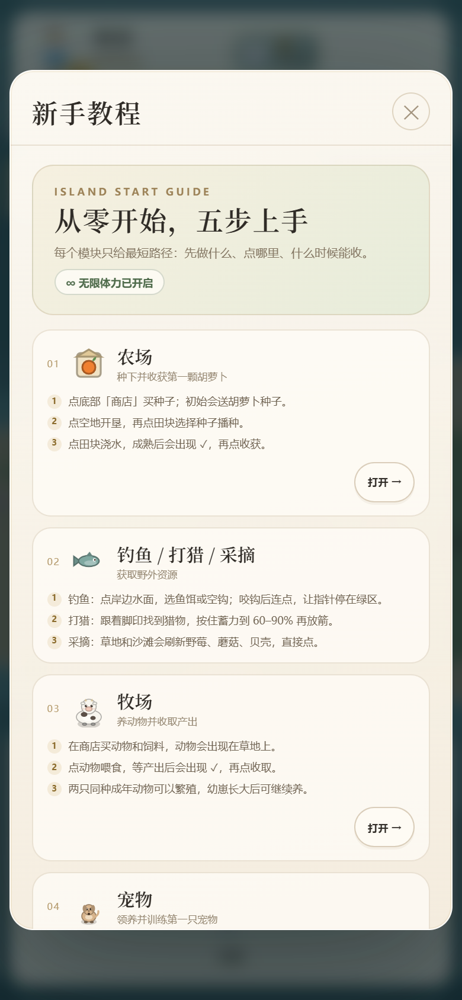

### 3. 触屏精度

- 拖拽改用真实手指位移（原 `movementX` 在触屏上常为 0）
- 触屏拖拽阈值 6 → 12px，减少误触
- 点选落点上移 10px，避开手指遮挡
- 粗指针设备按钮加大：HUD ≥56px、菜单按钮 ≥48px
- 手机 HUD 固定 **7×2**，14 个入口不再出现单独第三行
- 实测手机拖拽：相机位移 -60 / -40，符合手指移动

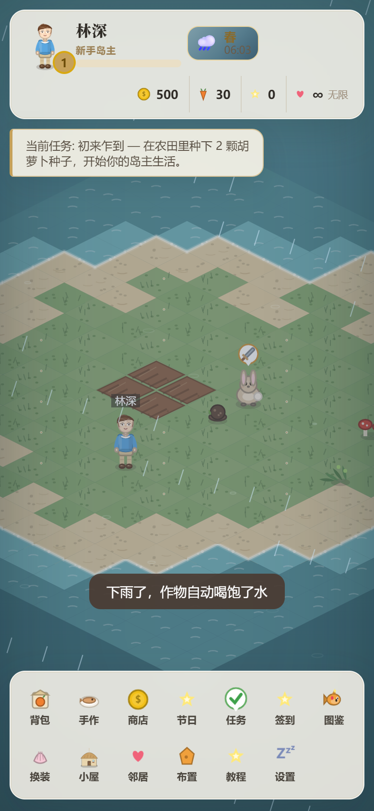

### 4. 角色重做

- 约 **3.2 头身**，更修长
- 颈部/锁骨、收腰上衣、V 领、袖口、手部
- 椭圆脸 + 收窄下巴、面颊/下颌阴影
- 杏眼、眼白/虹膜/瞳孔/高光、细眼线、眼睑褶皱
- 细眉、鼻梁、自然唇色、腮红
- 侧分刘海、发丝高光、脸侧碎发
- 更小的手与鞋，鞋面/鞋底/高光


### 5. 验证

- `npm run typecheck` 通过
- `npm test`：**38 个测试文件 / 227 项全部通过**
- `npm run build` 通过
- 手机 390px：教程 13 张、跳转商店正常、0 溢出、0 报错
- HUD 14 个入口，7×2 排列
- 版本 **9.0.0**，存档版本保持 **v31**

## v8.3 交付审计

### 1. 审计结果

- 停掉旧预览进程后执行 `npm ci`，从 lockfile 干净安装成功
- `npm run typecheck` 通过
- `npm test`：**38 个测试文件 / 227 项全部通过**
- `npm run build` 通过，产物在 `dist/`
- 文档引用的 45 张截图全部存在
- 桌面/手机面板回归：0 横向溢出、0 控制台报错

### 2. 单文件离线版

- 新增 `scripts/build-portable.mjs` 与 `npm run build:portable`
- 首次内联把脚本放在 `<head>`，早于 DOM 执行，导致 `append` 空指针
- 改为注入到 `</body>` 前，问题修复
- 产物：`release/ParadiseIsle.html`（约 477 KB）
- Edge 以 `file://` 打开：标题页、开局、HUD、Canvas 全部正常
- 刷新后存档仍在（localStorage）

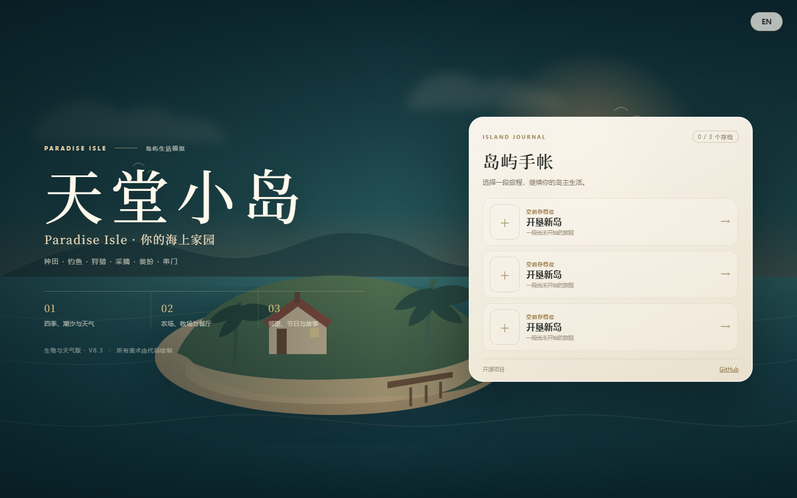

### 3. 静态网站包

- `release/ParadiseIsle-site.zip`：完整 `dist` 静态站点
- 可拖到 Netlify Drop / Cloudflare Pages / GitHub Pages
- 仓库已有 `.github/workflows/ci.yml`，推送到 `main` 自动部署 Pages

### 4. 公网临时入口

- 重启 `vite preview` 与 cloudflared 快速隧道
- 公网根页面与游戏入口实测 200，控制台 0 报错
- 快速隧道会过期，长期网址请用静态托管

### 5. 验证

- `npm run typecheck` 通过
- `npm test`：**227 项全部通过**
- `npm run build` 通过
- `file://` 与 HTTP 两种方式均实测可玩
- 存档版本保持 **v31**

### 6. GitHub Pages 上线

- 仓库：https://github.com/Jerry-pixel310/paradise-isle
- 在线试玩：https://jerry-pixel310.github.io/paradise-isle/
- GitHub Actions 自动跑类型检查、227 项测试、构建并部署 Pages
- 已实测网页 200、标题页 / 开局 / HUD / Canvas 正常，0 控制台报错

## v8.2 验收收口

### 1. 柔和雪斑

- 冬季地面不再整块菱形铺白
- 每格叠 3 个不同大小的柔和雪斑
- 保留积雪弧线与雪点
- 明显减弱棋盘感

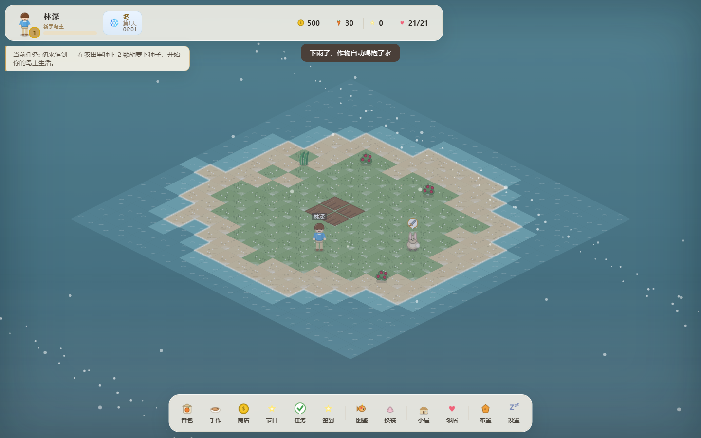

### 2. 最终回归

桌面 1440px 与手机 390px：

- 背包、手作、商店、节日、任务、签到、图鉴、换装、邻居、设置
- 岛主名片、天气
- 全部正常打开，横向溢出 **0**，控制台 **0 报错**

### 3. 验收缺口

- ✅ 冬季雪天实机已验收
- ✅ 7 种野兽实机已验收
- ✅ 生物 6 种轮廓已验收
- ✅ 雨/雪/暴风雪/晴天粒子已验收

### 4. 验证

- `npm run typecheck` 通过
- `npm test`：**38 个测试文件 / 227 项全部通过**
- `npm run build` 通过
- 存档版本保持 **v31**

## v8.1 验收补齐

### 1. 冬季雪天实机

- 通过把存档调整到冬季第 21 天并选用下雪种子
- 验证双层飘雪、积雪雾与地面薄雪
- 地面薄雪透明度从 0.16 提高到 0.24，积雪弧线更清楚


### 2. 野兽实机

- 野猪、猴子、狼、鳄鱼、熊、石像、龙 7 种同屏
- 验证长身/高身轮廓、獠牙、背棘、翼骨、尾刺、珊瑚裂缝暖光

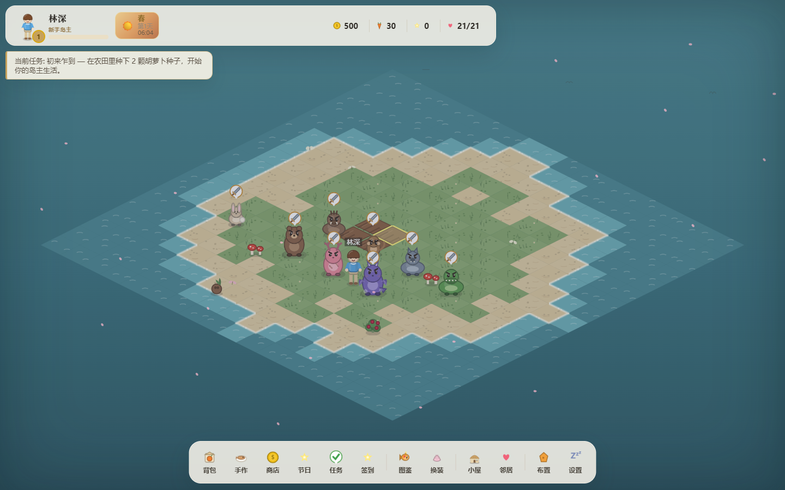

### 3. 验证

- `npm run typecheck` 通过
- `npm test`：**38 个测试文件 / 227 项全部通过**
- `npm run build` 通过
- 浏览器实测：冬季雪天、野兽同屏渲染正常，控制台 0 报错
- 存档版本保持 **v31**

## v8.0 生物与天气收口

### 1. 生物体态

- 圆身 / 长身 / 高身 / 鸟形 / 鱼形 / 盘蛇 6 种轮廓
- 牛、羊、狼等长身；羊驼、熊、龙等高身
- 鸡鸭鸟形带尾羽；海豚鱼形带尾鳍
- 头部、鼻口、腮红、小脚继续统一

### 2. 天气与光照

- 雨：雨雾、压暗、26 个地面涟漪
- 暴风雨：低垂云层、更强压暗、闪电
- 雪：远/近双层飘雪、积雪雾、冬季地面薄雪
- 晴：蝴蝶、夏季蜻蜓
- 天气切换 1.4 秒淡入
- 手机端粒子自动降级

### 3. 环境动效

- 春花瓣、秋落叶、夏浮尘
- 夏夜萤火虫 24 只，其他季节 18 只
- 晴天鸟群
- 室内窗光、月夜、房屋窗光

### 4. 最终验收

桌面 1440px 与手机 390px 分别打开：

- 背包、手作、商店、节日、任务、签到、图鉴、换装、邻居、设置
- 岛主名片、天气与预报

结果：

- 全部面板正常打开
- 横向溢出全部 **0**
- 控制台 **0 报错**
- 手机雨天场景正常

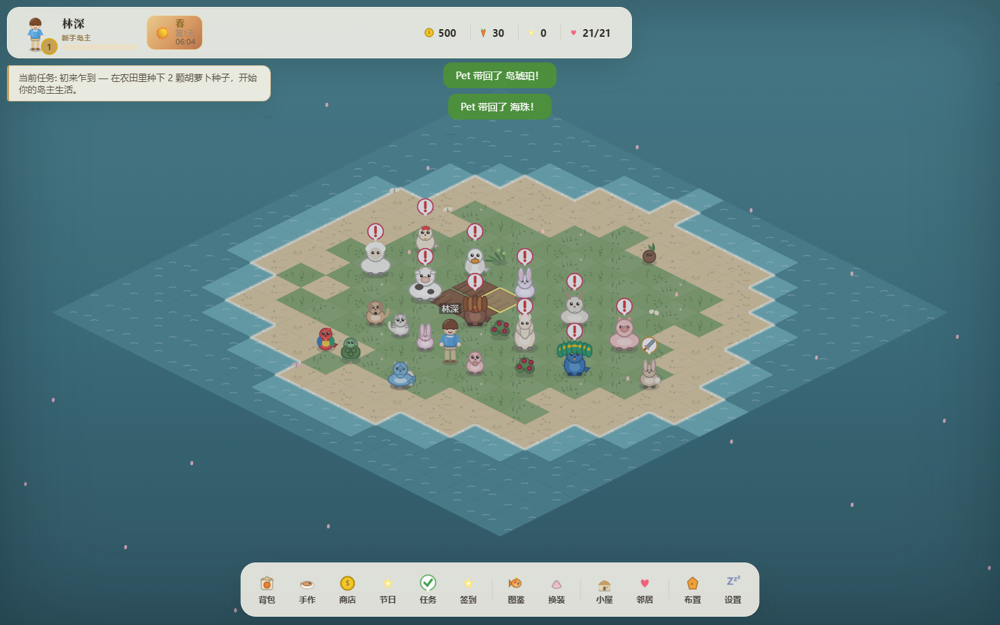
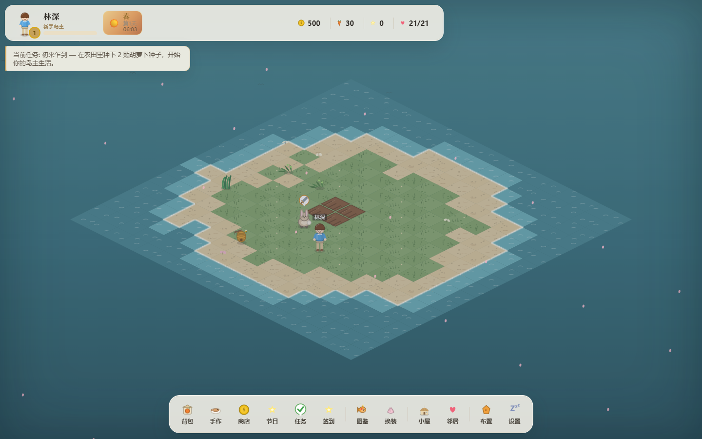
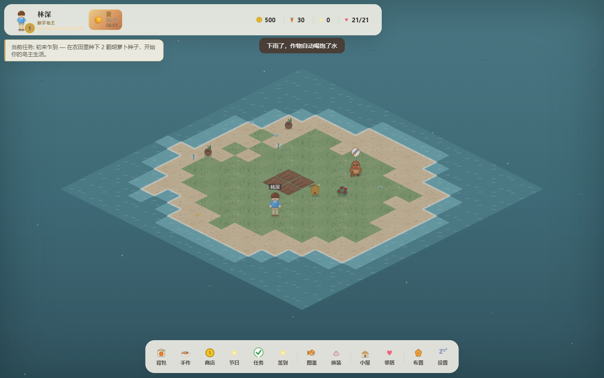
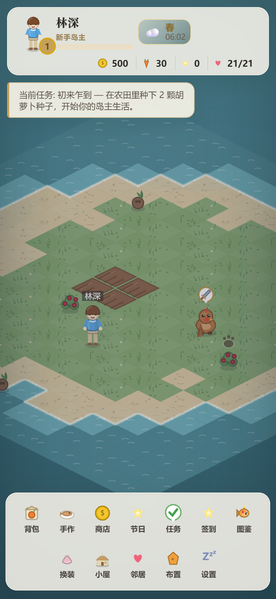

### 5. 验证

- `npm run typecheck` 通过
- `npm test`：**38 个测试文件 / 227 项全部通过**
- `npm run build` 通过
- 存档版本保持 **v31**

> 说明：冬季画面因测试存档日期限制未截到实机图；冬季地面薄雪与双层飘雪已通过构建与类型检查。

## v7.6 天气过渡与野兽细节

### 1. 天气淡入

- 记录上一帧天气
- 天气变化后，粒子与天气滤镜在 1.4 秒内淡入
- 不再突然出现/消失
- 首次进入游戏不触发淡入

### 2. 野兽细节

- 龙：翼骨线、尾刺
- 石像：珊瑚裂缝里的暖光
- 原有角、獠牙、背棘、翅膀、雾气保留

### 3. 验证

- `npm run typecheck` 通过
- `npm test`：**38 个测试文件 / 227 项全部通过**
- `npm run build` 通过
- 浏览器实测：天气与场景渲染正常，控制台 0 报错
- 存档版本保持 **v31**

## v7.5 环境动效

### 1. 夏日蜻蜓

- 夏季晴天在水边低空悬停 4 只蜻蜓
- 四片半透明翅膀、细长身体、较大复眼
- 翅膀轻微扇动，位置缓慢漂移

### 2. 夏夜萤火虫

- 夏季夜晚萤火虫从 18 只增至 24 只
- 其他季节保持 18 只
- 仍只在晴朗/多云夜晚出现


### 3. 验证

- `npm run typecheck` 通过
- `npm test`：**38 个测试文件 / 227 项全部通过**
- `npm run build` 通过
- 浏览器实测：夏季场景正常，控制台 0 报错
- 存档版本保持 **v31**

## v7.4 天气第三轮

### 1. 冬季地面薄雪

- 冬季所有陆地瓦片叠加半透明白色薄雪
- 每块地加 2 条积雪弧线
- 保留原有雪点
- 雪天粒子仍在其上

### 2. 手机端粒子降级

- 宽度 < 560px 时：
  - 雨丝 85 → 55，暴风雨 150 → 90
  - 涟漪 26 → 16
  - 远雪 90 → 60，近雪 26 → 16
  - 蝴蝶 6 → 4
- 桌面端数量不变

### 3. 验证

- `npm run typecheck` 通过
- `npm test`：**38 个测试文件 / 227 项全部通过**
- `npm run build` 通过
- 浏览器实测：390px 手机雨天 0 溢出、0 报错
- 存档版本保持 **v31**

## v7.3 天气第二轮

### 1. 雪天

- 远层细雪 90 粒
- 近层大雪花 26 粒，更慢、更亮
- 地平线附近加入积雪雾
- 保留冬季地面雪点

### 2. 暴风雨

- 顶部低垂云层缓慢移动
- 压暗比普通雨天更明显
- 保留雨丝、涟漪与闪电

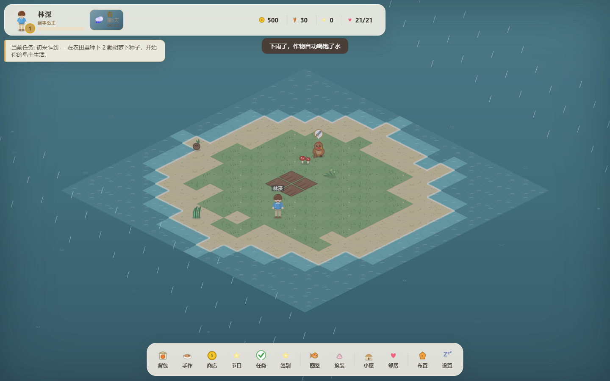

### 3. 验证

- `npm run typecheck` 通过
- `npm test`：**38 个测试文件 / 227 项全部通过**
- `npm run build` 通过
- 浏览器实测：雨天/晴天渲染正常，控制台 0 报错
- 存档版本保持 **v31**

## v7.2 天气第一轮

### 1. 雨天

- 雨天整体轻微压暗、加入淡蓝灰雨雾
- 地面/水面出现 26 个扩散雨滴涟漪
- 暴风雨压暗更明显，涟漪更大

### 2. 晴天蝴蝶

- 春/夏晴天在草地上出现 6 只低飞蝴蝶
- 翅膀开合、身体轻微旋转
- 春季粉/米白，夏季金/蓝配色


### 3. 验证

- `npm run typecheck` 通过
- `npm test`：**38 个测试文件 / 227 项全部通过**
- `npm run build` 通过
- 浏览器实测：晴天/雨天渲染正常，控制台 0 报错
- 存档版本保持 **v31**

## v7.1 生物体态第一轮

### 1. 六种身体轮廓

- `round` 圆身：兔子、乌龟、猫狗等小体型
- `long` 长身：牛、羊、山羊、猪、狼、野猪、鳄鱼、狐狸
- `tall` 高身：羊驼、熊、猴子、石像、龙
- `bird` 鸟形：鸡、鸭、火鸡、孔雀、鹦鹉，带尾羽
- `fish` 鱼形：海豚，横向身体 + 尾鳍
- `serpent` 盘蛇：蛇类盘绕身体 + 抬头

### 2. 兼容性

- 头部、眼睛、鼻口、腮红、小脚继续共用
- 物种特征（角、喙、鸡冠、尾屏、壳、背鳍）保留
- 体型缩放 `size` 继续生效


### 3. 验证

- `npm run typecheck` 通过
- `npm test`：**38 个测试文件 / 227 项全部通过**
- `npm run build` 通过
- 浏览器实测：动物/宠物同屏渲染正常，控制台 0 报错
- 存档版本保持 **v31**

## v7.0 游戏内美术收口

### 1. 最终修复

- 清晨/黄昏不再误显示月亮、星点与萤火虫
- 手机提示条从顶部移到工具栏上方，不再遮挡资源栏和任务

### 2. 美术提升总览

- **地形**：鼠尾草草地、沙岩沙滩、海松蓝海水、草叶/野花/沙纹
- **海岸**：四向浪花遮罩 + 柔白碎点
- **角色**：约 3 头身、面部柔光、衣褶、头发高光、走路起伏
- **动物**：身体/头部柔光、鼻口、腮红、立足小脚
- **建筑**：石基、墙角明暗、窗台花箱、瓦线/屋脊高光、门阶
- **树木**：树冠叶簇、树干高光
- **季节**：春夏秋冬色温、夏季浮尘、春花瓣、秋落叶、冬积雪
- **夜景**：月亮、星点、萤火虫、路灯光池、房屋窗光
- **室内**：窗光体积光 + 壁炉光 + 暖色暗角
- **道路**：受光边/背光边
- **动效**：晴天鸟群、成熟作物露光

### 3. 最终验收

桌面 1440px 与手机 390px 分别打开：

- 背包、手作、商店、节日、任务、签到、图鉴、换装、邻居、设置
- 岛主名片、天气与预报

结果：

- 全部面板正常打开
- 横向溢出全部 **0**
- 控制台 **0 报错**
- 手机场景 390px 正常，提示条不再遮挡

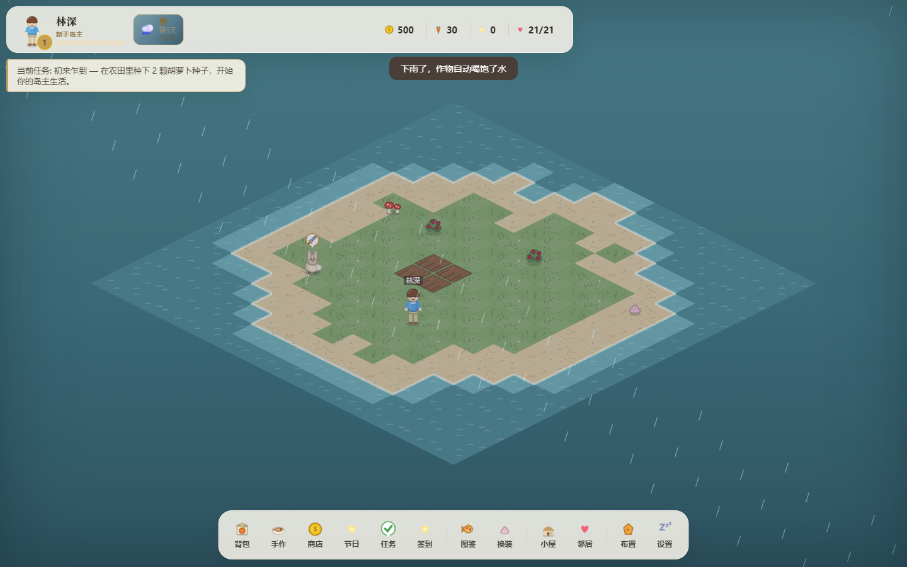
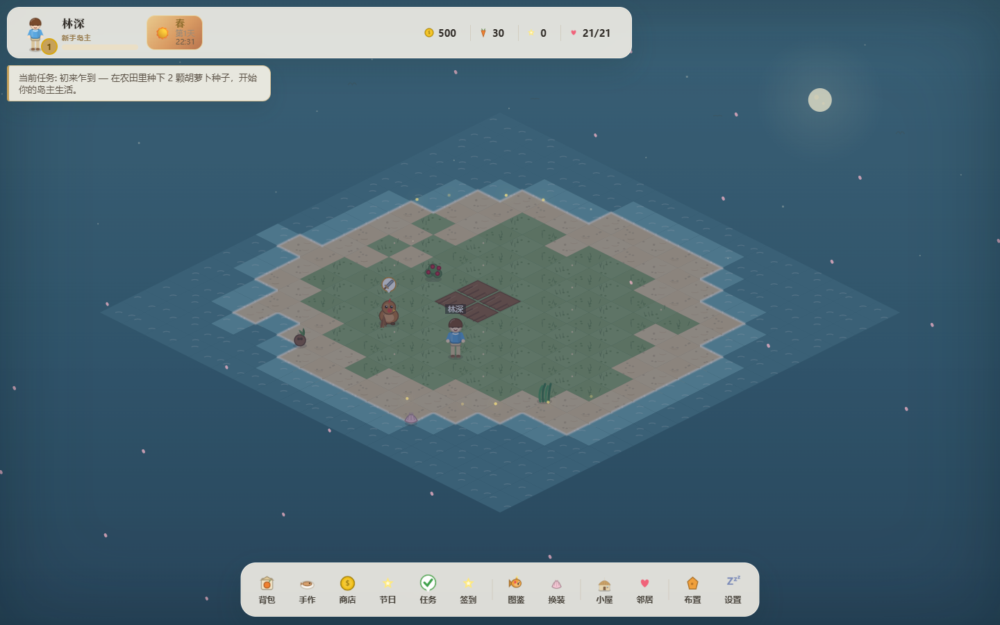
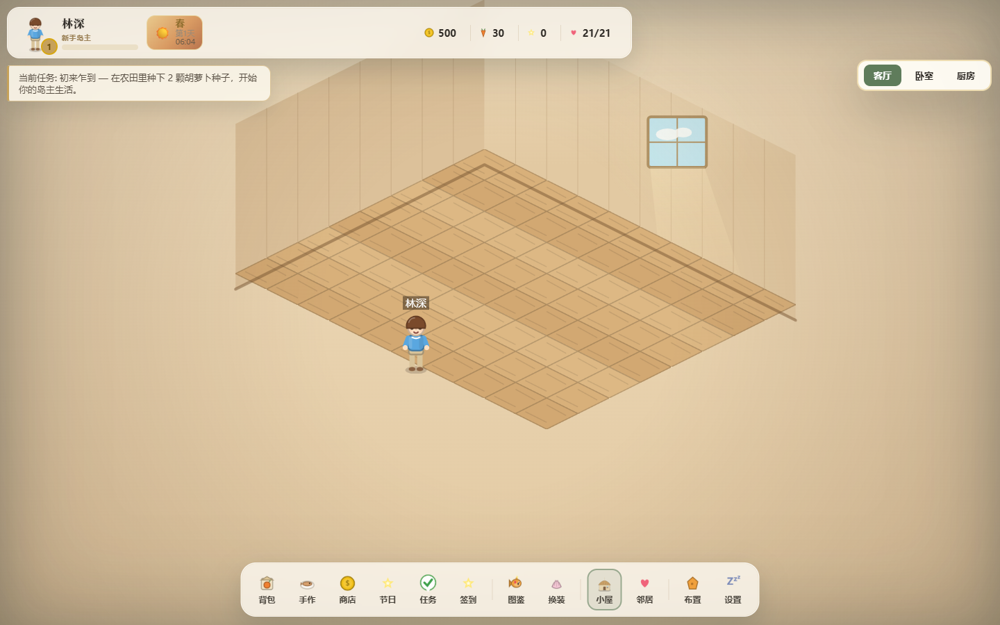


### 4. 验证

- `npm run typecheck` 通过
- `npm test`：**38 个测试文件 / 227 项全部通过**
- `npm run build` 通过
- 存档版本保持 **v31**

## v6.8 游戏内美术第九轮

### 1. 晴天鸟群

- 晴天时远处有 4 只小鸟缓慢掠过
- 翅膀有轻微扇动
- 不参与碰撞，不影响操作

### 2. 成熟作物露光

- 可收获作物顶部出现 3 个细小露光点
- 光点随时间轻微呼吸
- 与原有可收获图标叠加，不替代图标

### 3. 验证

- `npm run typecheck` 通过
- `npm test`：**38 个测试文件 / 227 项全部通过**
- `npm run build` 通过
- 浏览器实测：场景渲染正常，控制台 0 报错
- 存档版本保持 **v31**

## v6.7 游戏内美术第八轮

### 1. 室内窗光

- 从窗台向地板投射一块梯形体积光
- 靠近窗户处更亮，向地板远端渐隐
- 窗口周围再加一层柔和径向光
- 家具绘制在光之后，仍保持正确遮挡

### 2. 与原有室内光的关系

- 保留暖色暗角
- 保留壁炉暖光
- 窗光 + 壁炉光 + 暗角形成三层室内光照


### 3. 验证

- `npm run typecheck` 通过
- `npm test`：**38 个测试文件 / 227 项全部通过**
- `npm run build` 通过
- 浏览器实测：进入小屋后窗光正常，控制台 0 报错
- 存档版本保持 **v31**

## v6.6 游戏内美术第七轮

### 1. 四季色温

- 春：柔和的鼠尾草绿
- 夏：暖金色阳光
- 秋：琥珀色
- 冬：冷蓝灰
- 春花瓣 / 秋落叶 / 冬积雪保留

### 2. 夏季浮尘

- 晴天夏季出现缓慢漂移的金色小尘点
- 不遮挡角色与 UI

### 3. 道路边缘

- 道路菱形上缘加受光边
- 下缘加背光边
- 4 种道路（沙/石/木/砖）共用

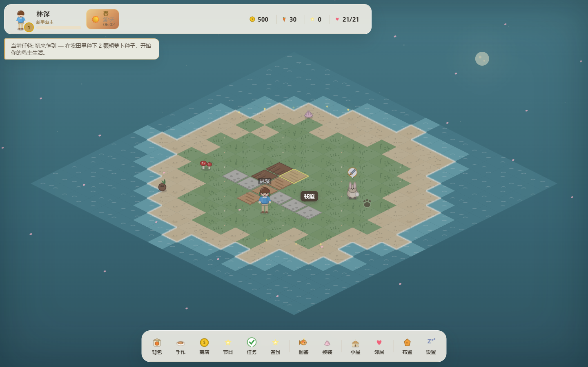

### 4. 验证

- `npm run typecheck` 通过
- `npm test`：**38 个测试文件 / 227 项全部通过**
- `npm run build` 通过
- 浏览器实测：道路、季节渲染正常，控制台 0 报错
- 存档版本保持 **v31**

## v6.5 游戏内美术第六轮

### 1. 动物立足姿态

- 动物/野兽/宠物统一增加两只小脚，不再像悬浮圆团
- 鸟、蛇、海豚、乌龟关闭小脚，保持原体态
- 身体/头部柔光、鼻口、腮红继续保留
- 物种特征（鸡冠、鸭喙、兔耳、羊角、壳等）不变

### 2. 夜晚房屋窗光

- 夜晚房屋墙面透出暖色光晕
- 与路灯光池、月光、萤火虫形成完整夜间光源层次
- 只对 `house` 类建筑生效

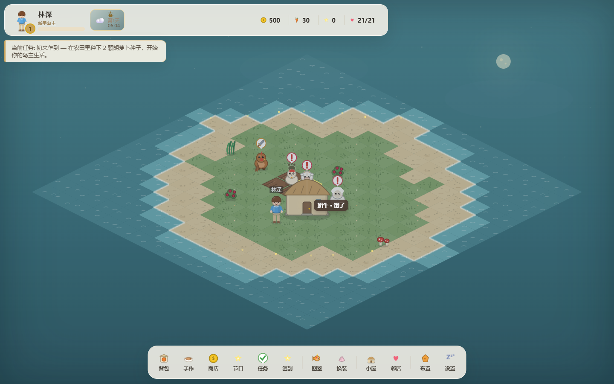

### 3. 验证

- `npm run typecheck` 通过
- `npm test`：**38 个测试文件 / 227 项全部通过**
- `npm run build` 通过
- 浏览器实测：动物/房屋夜间效果正常，控制台 0 报错
- 存档版本保持 **v31**

## v6.4 游戏内美术第五轮

### 1. 角色比例

- 头半径从 11 调整为 8.5
- 身体高度从 16 调整为 20，腿从 8 调整为 15
- 整体从约 2.2 头身变为约 3 头身
- 头部、发型、帽子、服装、配饰仍使用同一套相对坐标

### 2. 兼容性

- 所有服装/表情/帽子/配饰样式保留
- 走路身体起伏、腿部摆动正常
- 换装预览、世界角色、名片头像同步更新


### 3. 验证

- `npm run typecheck` 通过
- `npm test`：**38 个测试文件 / 227 项全部通过**
- `npm run build` 通过
- 浏览器实测：造型室与角色绘制正常，控制台 0 报错
- 存档版本保持 **v31**

## v6.3 游戏内美术第四轮

### 1. 角色动作

- 走路时上半身随步伐轻微起伏，脚步仍贴地
- 保留原有腿部摆动与手臂摆动
- 站立时完全静止，不影响换装预览

### 2. 夜景氛围

- 晴夜/多云夜出现月亮、柔和月晕与星点
- 路灯/篝火/灯塔增加地面光池
- 萤火虫、月亮与暗角形成完整夜景层次


### 3. 农田细节

- 田埂增加受光边
- 土壤加入小石子
- 干/湿土颜色与犁沟保留

### 4. 验证

- `npm run typecheck` 通过
- `npm test`：**38 个测试文件 / 227 项全部通过**
- `npm run build` 通过
- 浏览器实测：月光夜景、萤火虫、角色行走正常，控制台 0 报错
- 存档版本保持 **v31**

## v6.2 游戏内美术第三轮

### 1. 房屋细化

- 石质地基与门阶
- 墙面右侧阴影 / 左侧受光面
- 窗户玻璃暖色反光与窗台
- 小屋/海景房/别墅窗台花箱
- 坡屋顶瓦线、檐口阴影、屋脊高光
- 茅草屋顶增加草束纹理与屋脊高光

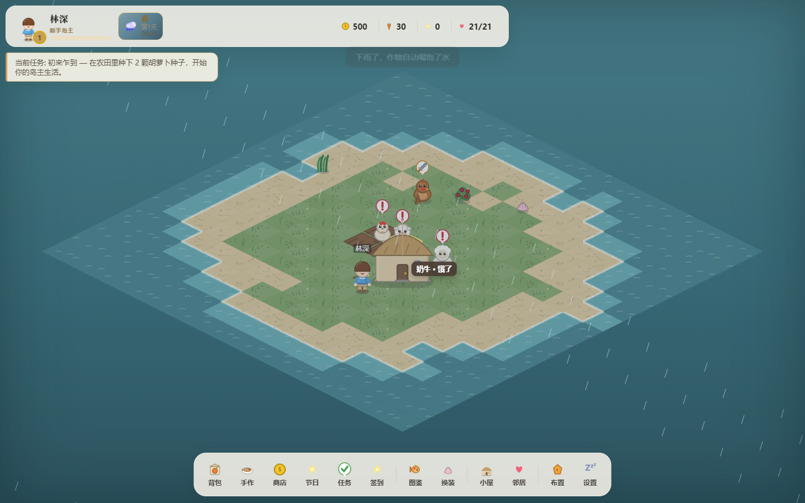

### 2. 动物细化

- 身体与头部柔光
- 鼻口与极轻腮红
- 所有动物/野兽/宠物共用同一套光影语言
- 原有物种特征（鸡冠、鸭喙、兔耳、羊角等）保留

### 3. 验证

- `npm run typecheck` 通过
- `npm test`：**38 个测试文件 / 227 项全部通过**
- `npm run build` 通过
- 浏览器实测：房屋、动物正常，控制台 0 报错
- 存档版本保持 **v31**

## v6.1 游戏内美术第二轮

### 1. 海岸浪花

- 每块靠岸浅水根据相邻陆地方向生成 4 向遮罩
- 地形全部绘制完后再统一叠加浪花，避免被沙地盖住
- 浪花由柔白描边 + 碎点组成，只出现在陆海交界

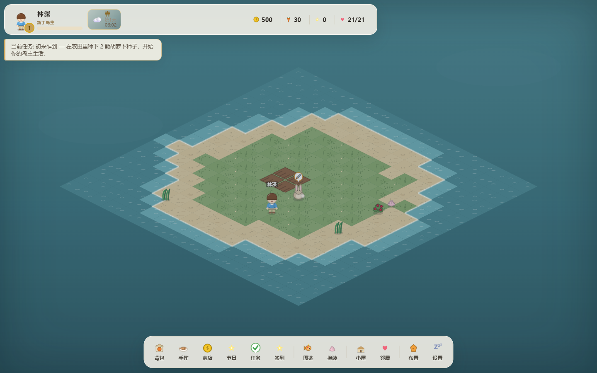

### 2. 夜间萤火虫

- 晴朗/多云夜晚在岛边生成 18 个漂移光点
- 暖黄色微光、随时间呼吸与漂移
- 雨/雪/暴风雨夜不出现

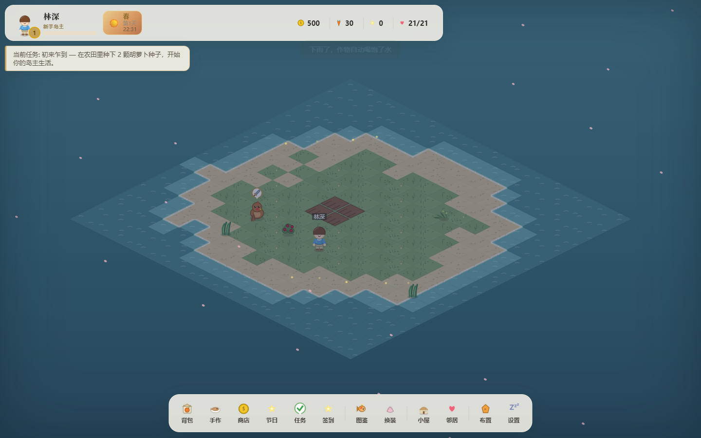

### 3. 树木细节

- 树冠加入深色叶簇与高光点，不再是一整块圆形
- 树干加入柔和高光
- 棕榈树保留原有形态

### 4. 验证

- `npm run typecheck` 通过
- `npm test`：**38 个测试文件 / 227 项全部通过**
- `npm run build` 通过
- 浏览器实测：白天海岸、晴朗夜晚萤火虫正常，控制台 0 报错
- 存档版本保持 **v31**

## v6.0 游戏内美术第一轮

### 1. 自然色地形

- 草地从高饱和亮绿改为鼠尾草绿/橄榄绿
- 沙滩改为沙岩色，水面改为海松蓝
- 海洋背景由亮青改为上浅下深的渐变海面
- 深水/浅水仍保留色阶差异

### 2. 地形细节

- 草地：随机草叶 + 偶发极小野花，不再是一块纯色菱形
- 沙滩：细碎沙纹
- 水面：波光保留但降低对比，避免网格感
- 地形暗角与 UI 暖纸色更协调

### 3. 角色细节

- 面部柔光、鼻尖与极轻腮红
- 上装左柔光 / 右阴影，衣服不再是一块平色
- 头发高光弧线
- 保留原有全部服装/表情/帽子/配饰绘制

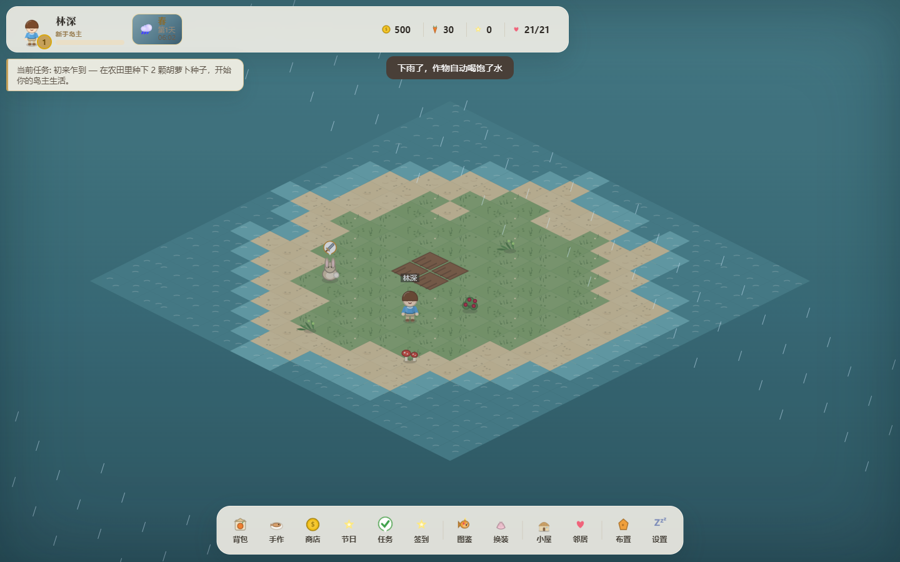
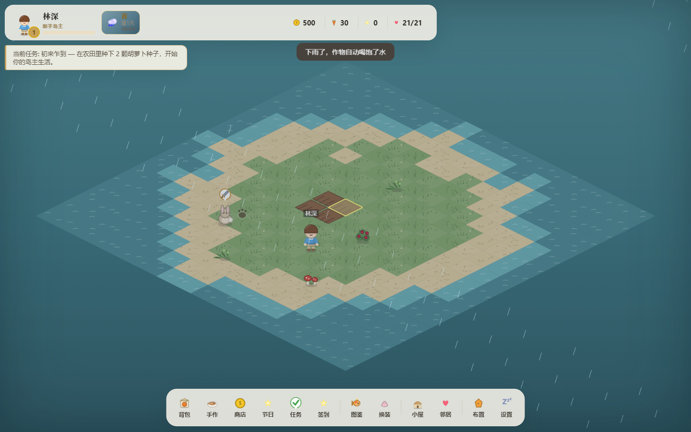

### 4. 验证

- `npm run typecheck` 通过
- `npm test`：**38 个测试文件 / 227 项全部通过**
- `npm run build` 通过
- 浏览器实测：新岛、开垦、UI 均正常，控制台 0 报错
- 存档版本保持 **v31**

## v5.7 全模块回归与 HUD 收口

### 1. HUD 分组

- 底部工具栏按「生活 / 收藏 / 地点 / 系统」加入细分隔线
- 手机端隐藏分隔线，自动折行
- 场景暗角、玻璃顶栏、称号与季节时钟保持统一

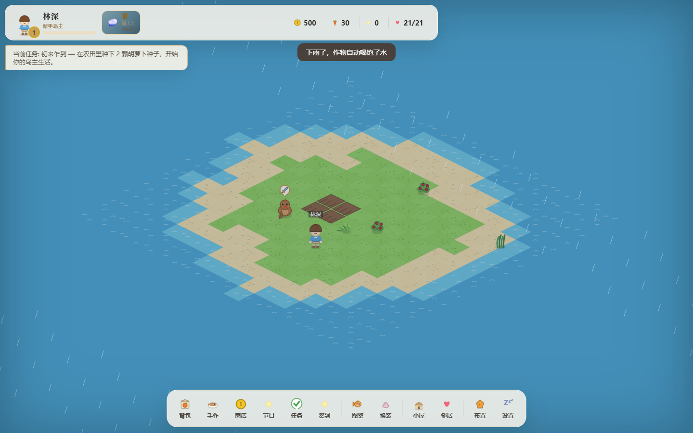

### 2. 全模块回归

桌面 1440px 与手机 390px 分别打开：

- 背包、手作、商店、节日、任务、签到、图鉴、换装、邻居、设置
- 岛主名片、天气与预报

结果：

- 全部面板正常打开，标题正确
- 横向溢出全部 **0**
- 控制台 **0 报错**

### 3. 已完成的面板清单

开场/读档、造型室、商店、任务/订单/评级/成就/统计、图鉴、邻居、手作、背包、节日、家具、餐厅、博物馆、设置、天气、宠物大赛、海岛手册、岛主名片、鱼塘投苗、牧场配对、签到。

### 4. 验证

- `npm run typecheck` 通过
- `npm test`：**38 个测试文件 / 227 项全部通过**
- `npm run build` 通过
- 存档版本保持 **v31**

## v5.6 全模块视觉重构（第六批）

### 1. 鱼塘投苗

- 页头改为 `FISH POND` + 可投鱼种数
- 鱼苗改为选择器卡片：鱼图、稀有度角标、背包数量、投放按钮

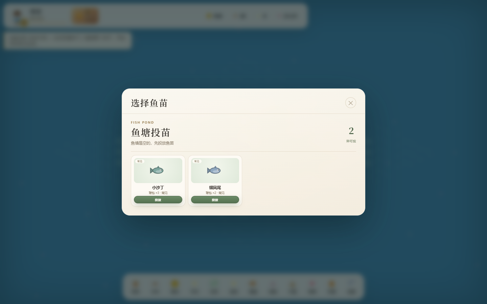

### 2. 牧场配对

- 页头改为 `RANCH MATCH` + 候选数量
- 配偶改为动物选择卡：头像、可繁殖/冷却状态、选择按钮


### 3. 签到

- 顶部改为连续签到徽章 + 连续/累计天数 + 领取按钮
- 7 天奖励条保留，并给已领取日期加盖章、下一天高亮
- 手机端奖励条自动折成 4 列


### 4. 验证

- `npm run typecheck` 通过
- `npm test`：**38 个测试文件 / 227 项全部通过**
- `npm run build` 通过
- 浏览器实测：鱼塘投苗/牧场配对/签到正常；控制台 0 报错
- 存档版本保持 **v31**

## v5.5 全模块视觉重构（第五批）

### 1. 帮助：海岛手册

- 32 条说明按主题分成六张卡片：操作 / 探索与天气 / 农场与牧场 / 小屋与收藏 / 邻里与活动 / 成长与目标
- 双列纸卡排版，替代原来的超长项目符号列表
- 手机端自动单列


### 2. 岛主名片：徽章墙

- 顶部名片头：大头像、岛主名、当前称号、等级/星级/天数/宠物
- 右侧成就完成度圆环
- 14 个称号改为双列徽章卡：首字徽章、名称、解锁条件、装备状态
- 已装备称号金色高亮


### 3. 验证

- `npm run typecheck` 通过
- `npm test`：**38 个测试文件 / 227 项全部通过**
- `npm run build` 通过
- 浏览器实测：帮助、名片正常；控制台 0 报错
- 存档版本保持 **v31**

## v5.4 全模块视觉重构（第四批）

### 1. 天气：海岛气象台

- 页头改为随天气变色的气象舞台：晴/多云/雨/暴风雨/雪各自配色
- 大图标 + 天气名 + 日期时间 + 天气描述 + 影响标签
- 三日预报改为三张预报卡
- 今日鱼情改为鱼种卡网格，按稀有度描边

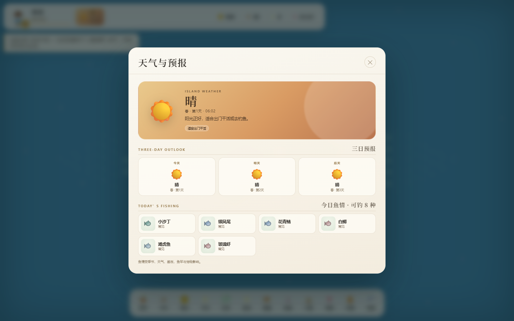

### 2. 宠物大赛：海岛秀场

- 页头改为 `SHOW RING`，显示参赛宠物数与规则
- S/A/B/C 排名图例
- 宠物改为秀场卡：头像、等级、品种、技能、参赛按钮
- 保留原有比赛结果弹窗与每日限制


### 3. 验证

- `npm run typecheck` 通过
- `npm test`：**38 个测试文件 / 227 项全部通过**
- `npm run build` 通过
- 浏览器实测：天气/宠物大赛正常；控制台 0 报错
- 存档版本保持 **v31**

## v5.3 全模块视觉重构（第三批）

### 1. 餐厅：今日厨房

- 页头改为 `SEASIDE KITCHEN` 特刊，显示今日菜单数量与营业状态
- 双栏布局：左侧今日菜单板（菜名/库存/大图），右侧营业预览（金币/声望/经验）
- 营业按钮直接显示预计收入
- 菜品库改为卡片网格，菜单 1/2 一键上架

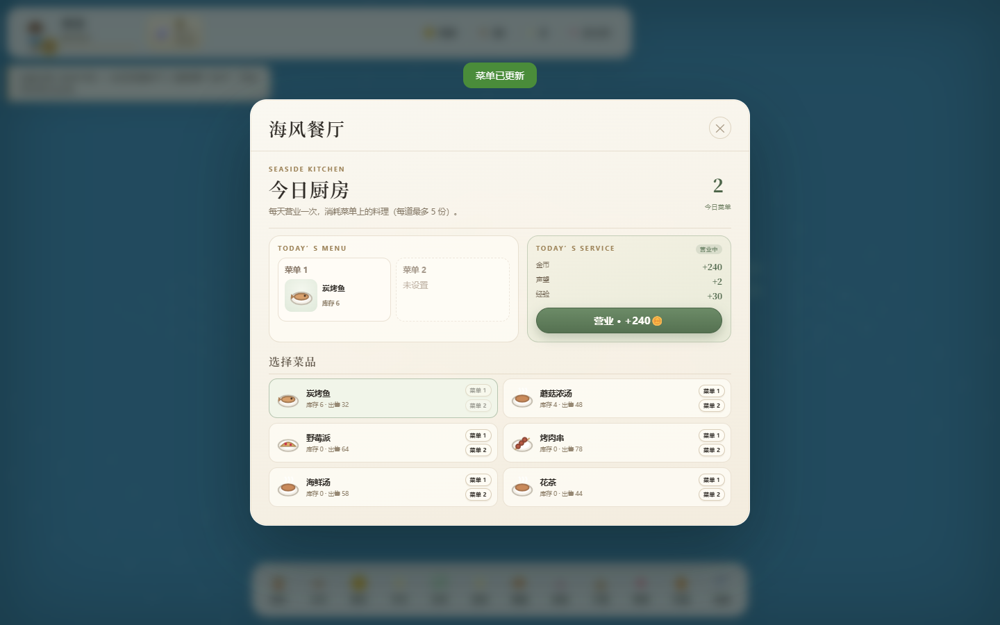

### 2. 博物馆：常设展厅

- 页头改为馆藏进度 + 里程碑奖励
- 展品改为展柜卡网格，带类别、已捐赠印章与捐赠按钮
- 保留按鱼类/采集/猎物/野兽分厅

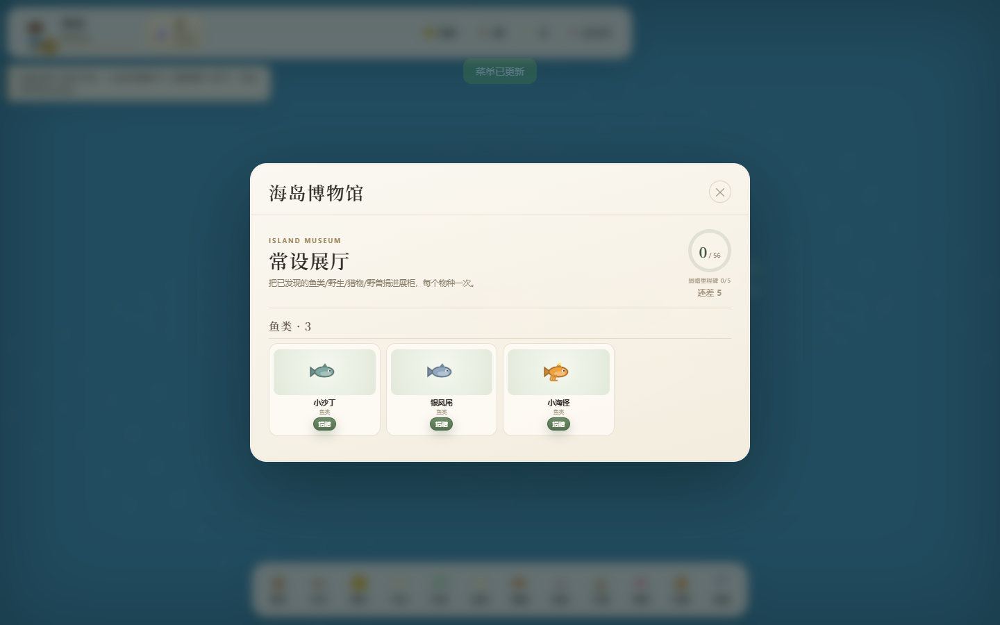

### 3. 设置：岛屿偏好

- 分为外观与语言 / 声音 / 存档三组
- 开关改为真正的 switch 控件，附说明
- 语言、像素滤镜、音效、音乐、导入导出、回标题集中管理
- 版本信息与美术说明独立页脚

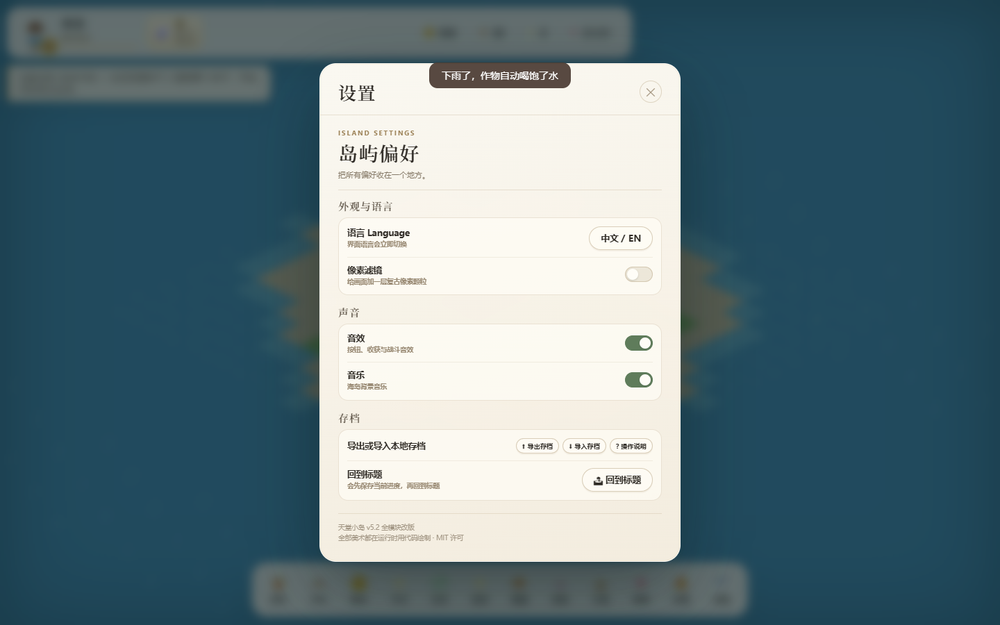

### 4. 场景暗角

- 游戏画布上增加一层极轻的内阴影暗角，只压住场景，不影响 HUD、面板或点击
- 让原本偏亮的等距场景更有层次

### 5. 验证

- `npm run typecheck` 通过
- `npm test`：**38 个测试文件 / 227 项全部通过**
- `npm run build` 通过
- 浏览器实测：餐厅、博物馆、设置正常；控制台 0 报错
- 存档版本保持 **v31**

## v5.2 全模块视觉重构（第二批）

### 1. 背包：随身仓库

- 顶部显示物品数、**总可售价值**与分类筛选
- 物品卡改为大图 + 数量角标 + 类别 + 单价 + 操作
- 料理直接显示食用按钮；可一键卖单件/全部
- 手机端两列紧凑网格

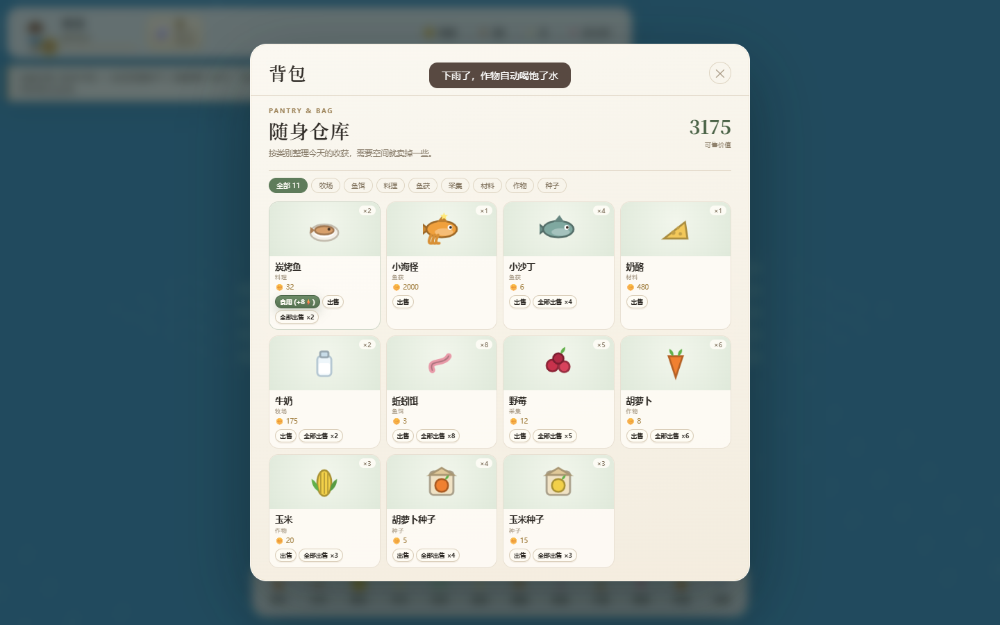

### 2. 节日：季节特刊

- 节日页头改为季节色特刊：节日名、描述、剩余天数
- 今日礼物独立卡片，领取按钮更明确
- 限定商品改为三列货架
- 节日挑战改为进度 + 三档奖励时间线

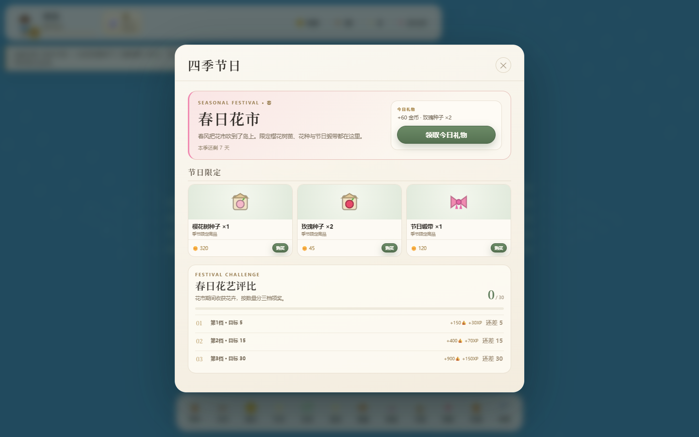

### 3. 家具：室内目录

- 家具商店改为目录卡网格：大图、槽位、美观度、价格
- 已摆放/在其它房间/已拥有/未解锁状态清晰
- 直接购买后进入摆放，保留原有全部交互

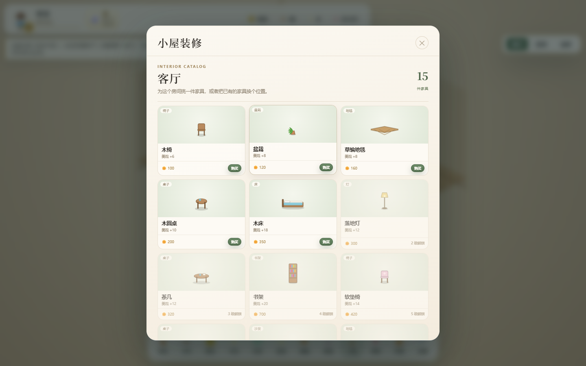

### 4. 验证

- `npm run typecheck` 通过
- `npm test`：**38 个测试文件 / 227 项全部通过**
- `npm run build` 通过
- 浏览器实测：背包、节日、家具目录正常；桌面/手机横向溢出 0，控制台 0 报错
- 存档版本保持 **v31**

## v5.1 全模块视觉重构（第一批）

### 1. 岛屿商店：杂志式货架

- 每个分类增加 `ISLAND MARKET` 导语、分类标题与钱包余额
- 长列表改为三列商品卡：大图、名称、生长/产出/美观信息、价格与购买按钮
- 服装分类直接显示**穿上该单品的角色缩略图**
- 手机端自动变为两列紧凑货架

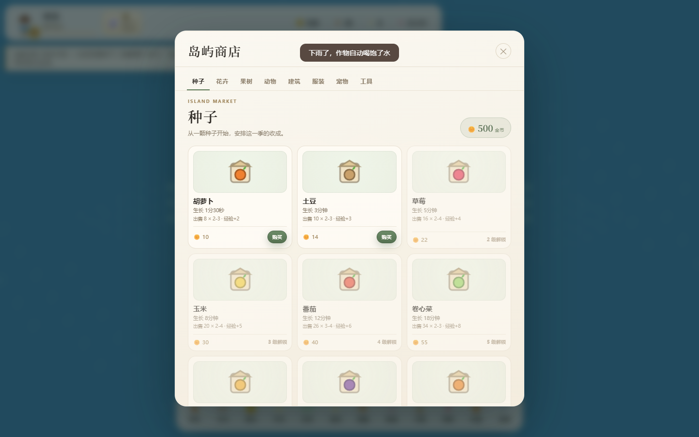

### 2. 任务 / 订单：岛主手帐

- 教程与每日任务改为竖向时间线，带编号、节点、步骤进度条与奖励
- 顶部增加完成度圆环与导语
- 订单改为带编号、库存进度条与委托条的票券样式


### 3. 图鉴：海岛野外笔记

- 顶部完成度圆环 + 「全部 / 已发现 / 未发现」筛选
- 展签式卡片：稀有度角标、发现数量、季节/天气/昼夜信息
- 未知物种只显示剪影与线索
- **修复鱼类图标全黑**：`hsl` 颜色不再传给只支持 hex 的 `shade()`，常见鱼改用稳定十六进制配色

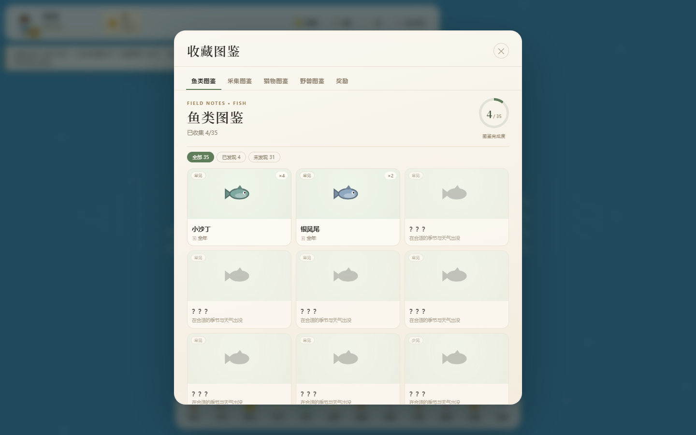

### 4. 邻居：岛民明信片

- 8 位邻居改为双列明信片卡片
- 角色头像、好友等级、生日、好友度进度条、每日帮忙/送礼/恶作剧次数
- 拜访、送礼、聊天、剧情、回礼、雇佣压缩为两列操作
- 好友码分享移到顶部工具条

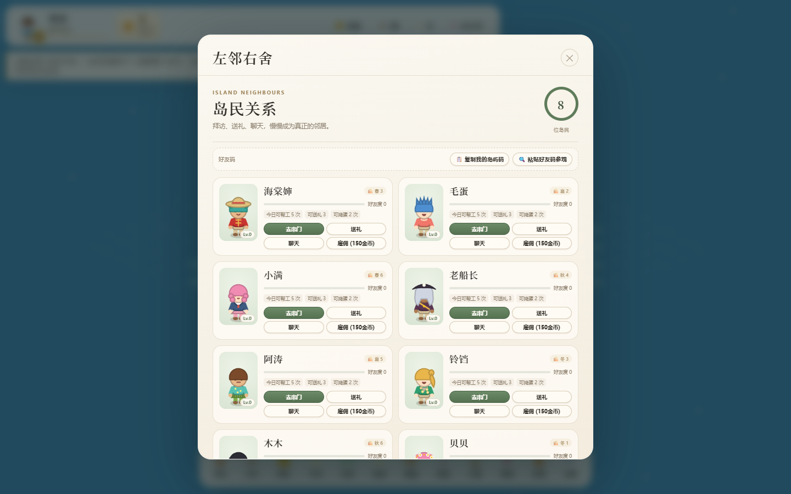

### 5. 手作：配方卡片

- 料理/花艺/牧场加工改为配方卡网格
- 大图产出、材料库存进度、恢复/售价/经验标签、缺料状态
- 厨房加成与分类导语集中在页头

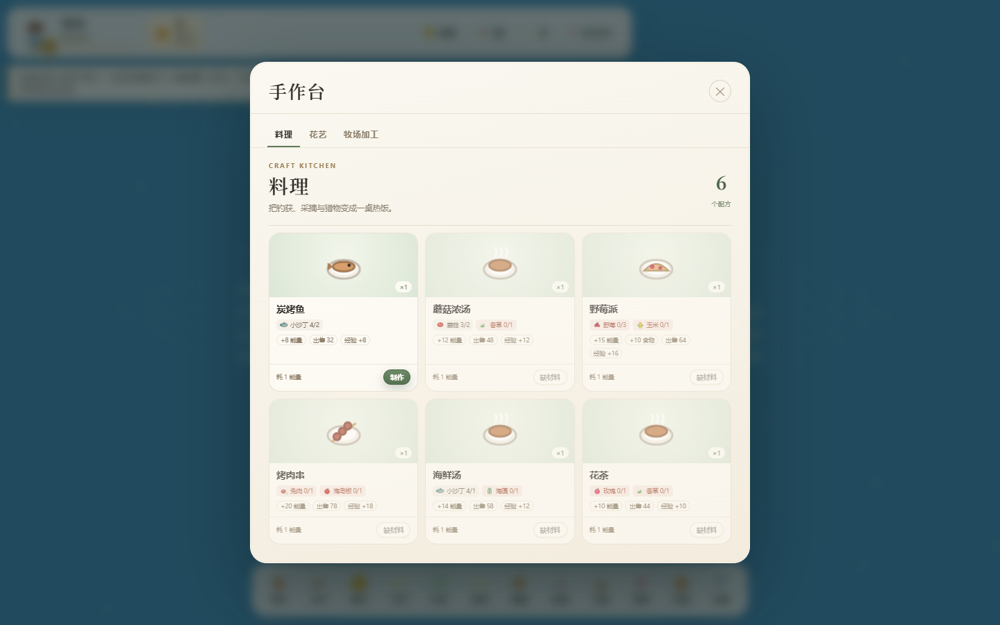

### 6. 验证

- `npm run typecheck` 通过
- `npm test`：**38 个测试文件 / 227 项全部通过**
- `npm run build` 通过
- 浏览器实测：商店、任务、订单、图鉴、邻居、手作全部正常；0 控制台报错
- 存档版本保持 **v31**

## v5.0 视觉改版

### 1. 开场页：黄昏海岛手帐

- 用代码绘制整幅黄昏海岛插画（天空渐变、落日、云、海面、岛屿、木屋、棕榈、栈桥），不引入外部图片
- 左侧改为杂志式标题区：衬线大标题、章节编号与版本信息
- 右侧「岛屿手帐」存档面板：
  - 每个存档显示角色头像、岛主名、等级、金币、游玩天数、保存时间
  - 最近一次存档带金色标记
  - 空存档位改为「尚未开始的旅程」
- 进入游戏时加入淡出/推近过渡

### 2. 换装：造型工作室

- 左侧大角色舞台 + 聚光/地面阴影 + 当前穿搭色调
- 圆形风格评分环 + 评分拆解条（基础 / 精品 / 配色 / 完整度）
- 衣橱改为带**角色缩略预览**的单品卡，而不是纯文字列表
- 新增「全部 / 仅已拥有」筛选、「随机搭配」、当前穿着标记
- 三套搭配存档改为拍立得式 Lookbook，支持应用、覆盖、清空

### 3. 全局视觉系统

- 配色从高饱和卡通色改为暖纸、深墨绿、陶土红、旧金色
- 标题使用衬线字体，正文使用无衬线字体
- 模态面板、标签页、按钮、HUD、商店/任务/图鉴卡片统一为细边框、克制圆角与柔和阴影
- 手机端同步适配；桌面 1440px 与手机 390px 横向溢出均为 0


### 4. 设计参考（只研究布局与质感，未复制任何素材/代码）

- [ac-site-template](https://github.com/yunxinz/ac-site-template)：暖奶油色、手帐式导航与圆润卡片
- [stardewOS](https://github.com/FernandoBade/stardewOS)：游戏化桌面 UI 的层级与木质/纸质感
- [animal_crossing_ui](https://github.com/sazardev/animal_crossing_ui)：cozy UI 的组件化与角色展示
- [animal-island-ui](https://github.com/guokaigdg/animal-island-ui)：动物森友会式界面的留白与圆角语言

### 5. 验证

- `npm run typecheck` 通过
- `npm test`：**38 个测试文件 / 227 项全部通过**
- `npm run build` 通过
- 浏览器实测：开场页、开新岛、造型室、商店、任务、背包均正常；桌面/手机横向溢出 0，控制台 0 报错
- 存档版本保持 **v31**，无存档字段变化

## v4.2 新增内容
### 1. 牧场加工

手作台新增 **牧场加工** 标签页，把养殖产出接入加工链：

| 产物 | 配方 | 售价 |
|---|---|---|
| 黄油 | 牛奶 ×1 | 260 |
| 奶酪 | 牛奶 ×2 | 480 |
| 羊奶酪 | 羊奶 ×2 | 420 |
| 毛线 | 羊毛 ×2 | 380 |
| 羊毛布料 | 羊毛 ×2 + 毛线 ×1 | 920 |
| 蛋挞 | 鸡蛋 ×2 + 牛奶 ×1 | 150（+10 能量） |
| 芝士吐司 | 奶酪 ×1 + 玉米 ×1 | 240（+18 能量） |

- 加工消耗 1 能量，并获得配方经验
- 新增 7 个物品图标（奶酪/黄油/毛线/布料/蛋挞/吐司等）
- 与繁殖、餐厅、订单形成更完整的牧场经济链

### 最终验收（第 30 轮）

- `npm run typecheck`：通过
- `npm test`：**38 个测试文件 / 227 项全部通过**
- `npm run build`：通过（dist 产物已更新）
- 浏览器冒烟：背包/手作/商店/节日/任务/签到/图鉴/换装/邻居/设置/名片/天气全部正常打开关闭，**0 控制台报错**
- 响应式：1400px 与 390px 宽度横向溢出均为 **0px**
- 存档：v1→v31 迁移链测试通过

### 2. 验证与存档

- 单元测试增加到 **227 项**
- 浏览器实测：牧场加工页 7 个配方正常显示，制作黄油与奶酪后牛奶 4→1、两种产物各 +1，无控制台报错
- 存档版本保持 **v31**（仅新增内容数据，无新存档字段）

## v4.1 新增内容

### 1. 岛主名片

- 点击左上角头像/名字打开「岛主名片」
- 名片显示：头像、名字、当前称号、等级、岛屿星级、成就完成数、游玩天数、宠物数
- 称号共 **14 个**，由里程碑自动解锁：
  - 新手岛主（初始）
  - 收获大师（收获 100）
  - 钓鱼佬（钓鱼 50）
  - 采集专家（采摘 30）
  - 岛屿猎手（狩猎 20）
  - 岛主厨师（烹饪 15）
  - 花艺师（收获花卉 20）
  - 育种家（杂交 5）
  - 牧场主（繁殖 10）
  - 岛屿设计师（摆放 25）
  - 博物馆馆长（捐赠 25）
  - 五星岛主（领完 5 档评级）
  - 签到元老（签到 30 天）
  - 金币大亨（累计赚 100,000 金币）
- 已解锁称号可装备，未解锁显示「未解锁」
- 装备后的称号显示在 HUD 名字下方

### 2. 验证与存档

- 存档版本升到 **v31**（补当前称号）
- 单元测试增加到 **223 项**
- 浏览器实测：收获 100 后解锁「收获大师」→ 名片装备 → HUD 从「新手岛主」变为「收获大师」，无控制台报错

## v4.0 新增内容

### 1. 每日签到

- 底部新增「签到」按钮，每天可领一次
- 7 天循环奖励：
  - 第 1 天：100 金币
  - 第 2 天：150 金币 + 5 食物
  - 第 3 天：220 金币 + 蚯蚓饵 ×3
  - 第 4 天：300 金币 + 玉米种子 ×2
  - 第 5 天：450 金币 + 鲜虾饵 ×3
  - 第 6 天：600 金币 + 5 食物
  - 第 7 天：1000 金币 + 节日缎带 ×1
- 连续签到奖励递增，断签重置连续天数
- 面板显示连续天数、累计天数与 7 天奖励条
- 新增统计与成就「签到达人」（1/7/30 天）

### 2. 验证与存档

- 存档版本升到 **v30**（补签到记录与统计）
- 单元测试增加到 **219 项**
- 浏览器实测：首次签到 +100 金币、连续 1 天、累计 1 天、按钮变「今日已签到」，无控制台报错

## v3.9 新增内容

### 1. 海岛博物馆

- 商店「建筑」页新增 **海岛博物馆**（12000 金币，Lv.20，3×3）
- 点击博物馆 →「参观博物馆」：
  - 展示已发现的鱼类/野生/猎物/野兽（共 56 种）
  - 每个物种可捐赠一次，不消耗背包物品
  - 已捐赠显示「已捐赠」，未发现物种不显示
- 捐赠里程碑：
  - 5 件 → 1000 金币
  - 15 件 → 2500 金币
  - 30 件 → 5000 金币
  - 50 件 → 9000 金币
  - 51 件 → 15000 金币
- 新增统计与成就「博物馆馆长」（1/10/25/50 件）

### 2. 验证与存档

- 存档版本升到 **v29**（补博物馆捐赠与里程碑）
- 单元测试增加到 **215 项**
- 浏览器实测：捐赠 5 种鱼 → 进度 5/56 → 领取第一档 +1000 金币，无控制台报错

## v3.8 新增内容

### 1. 家具互动

- 室内点击以下家具会出现「使用」动作，每个家具每天一次：
  - **床**：休息，恢复最多 30 能量
  - **沙发**：小憩，恢复最多 10 能量
  - **壁炉**：烤火，恢复最多 8 能量
  - **电视**：看电视，恢复最多 5 能量
- 能量已满时不会浪费每日次数
- 使用后按钮显示「今日已用」，隔天刷新
- 新增统计与成就「宅家达人」（1/10/50 次）

### 2. 验证与存档

- 存档版本升到 **v28**（补家具每日使用记录与统计）
- 单元测试增加到 **211 项**
- 浏览器实测：卧室床休息 → 能量 +21（上限）、按钮变「今日已用」，无控制台报错

## v3.7 新增内容

### 1. 动物繁殖

- 点击成年动物 →「繁殖」，选择同种成年配偶
- 繁殖消耗 **8 食物 + 2 能量**
- 新生幼崽：
  - **4 小时**后成年
  - 幼崽不能喂食/收取，头顶显示爱心
  - 幼崽成年后恢复普通产出循环
- 参与繁殖的两只动物进入 **12 小时**繁殖冷却
- 新增统计与成就「牧场繁育」（1/10/30 次）

### 2. 验证与存档

- 存档版本升到 **v27**（补幼崽出生/繁殖冷却与统计）
- 单元测试增加到 **207 项**
- 浏览器实测：两只小母鸡繁殖 → 幼崽出生、动物数 3、食物 -8、统计 +1，无控制台报错

## v3.6 新增内容

### 1. 海风餐厅

- 商店「建筑」页新增 **海风餐厅**（8000 金币，Lv.15，3×2）
- 点击餐厅 →「经营餐厅」打开面板：
  - 设置 **2 道菜单**（只能选烹饪料理）
  - 面板显示每道菜库存与营业额预览
  - **营业**：每天一次，消耗菜单料理（每道最多 5 份）
- 收益：
  - 金币 = 料理售价 × 数量 × 1.5
  - 声望 +1~8
  - 经验 = 卖出份数 ×6
- 新增统计与成就「餐厅老板」（1/10/50 次营业）

### 2. 验证与存档

- 存档版本升到 **v26**（补餐厅菜单/营业日与统计）
- 单元测试增加到 **203 项**
- 浏览器实测：设置炭烤鱼菜单 → 预计 +240 金币 → 营业消耗 5 份、金币 +240、统计 +1，无控制台报错

## v3.5 新增内容

### 1. 5 级鱼竿

- 工具页鱼竿升级扩展到 **5 级**：
  - 2 级：玻纤鱼竿（800）
  - 3 级：碳素大师竿（5,000）
  - 4 级：星辉钓竿（15,000）
  - 5 级：海神之竿（40,000）
- 满级后显示「海神之竿 · 已满级」，卡片显示「鱼竿升级：下一级名称」

### 2. 5 种深海鱼（总数 30 → 35）

| 鱼 | 稀有度 | 鱼竿 | 条件 |
|---|---|---|---|
| 深渊提灯鱼 | 传说 | 4 级 | 冬 · 多云/暴风雨 · 夜 |
| 水晶鳐 | 史诗 | 4 级 | 冬 · 晴/多云 · 白天 |
| 极光鱼 | 史诗 | 4 级 | 冬 · 雪 · 夜 |
| 利维坦 | 传说 | 5 级 | 夏 · 暴风雨 · 夜 |
| 虚空鲸 | 传说 | 5 级 | 冬 · 雪/暴风雨 · 夜 |

- 鱼类图鉴总数为 **35**，里程碑档位同步变为 9 / 18 / 27 / 35
- 天气面板「今日鱼情」会自动按鱼竿等级过滤

### 3. 验证

- 单元测试增加到 **198 项**
- 浏览器实测：连续升级鱼竿 4 次到 5 级、显示满级、图鉴显示 0/35，无控制台报错
- 存档版本保持 **v25**（复用已有 rodTier 字段，无新存档字段）

## v3.4 新增内容

### 1. 鱼塘养殖

- 商店「建筑」页新增 **鱼塘**（2500 金币，Lv.12，2×2）
- 点击鱼塘打开菜单：
  - **投放**：从背包选择鱼投入（每个鱼塘只能养一种鱼，最多 3 条）
  - **收获**：2 小时后可收获 `鱼苗数 + 1` 条同种鱼
  - 生长中显示剩余时间
- 收获后保留鱼苗并重新计时，可循环养殖
- 收纳鱼塘时会把塘里的鱼退回背包
- 新增统计与成就「鱼塘主」（1/10/30 次收获）

### 2. 验证与存档

- 存档版本升到 **v25**（补鱼塘状态与统计）
- 单元测试增加到 **196 项**
- 浏览器实测：放置鱼塘 → 投放沙丁鱼 → 2 小时后收获 ×2 → 鱼数量 3、统计 +1，无控制台报错

## v3.3 新增内容

### 1. 岛民生日

- 8 位邻居各有季节生日（春/夏/秋/冬 + 季节内第几天）
- 邻居卡片显示「生日 春第3天」，生日当天显示「🎂 今天生日」，送礼按钮变为「送礼 🎂」
- 生日当天送礼：
  - 好友度 **翻倍**
  - 首次送礼额外获得 **生日蛋糕 ×1 + 150 金币**
  - 生日回礼每个游戏年（28 天）只能领一次
- 新增特殊物品「生日蛋糕」，新增统计与成就「生日祝福」（1/5/15 次）

### 2. 验证与存档

- 存档版本升到 **v24**（补生日年份与统计）
- 单元测试增加到 **192 项**
- 浏览器实测：春第3天海棠婶生日 → 送礼好友度 +22、获得生日蛋糕、金币 +150，无控制台报错

## v3.2 新增内容

### 1. 作物品质

- 收获时按概率判定 **普通 / 银 / 金** 品质：
  - 基础：银 22%，金 6%
  - 近期浇过水：银 +10%，金 +3%
  - 岛屿美观度：银最多 +12%，金最多 +6%
  - 花卉基因活力：银 +8%×活力，金 +4%×活力
- 品质奖励：
  - 银品质：额外 **20%** 售价金币 + 20% 基础经验
  - 金品质：额外 **50%** 售价金币 + 50% 基础经验
- 收获时弹出「银/金品质收获」提示
- 新增统计「金/银品质收获次数」与成就「金牌农夫」（1/25/100 次金品质）

### 2. 验证与存档

- 存档版本升到 **v23**（补银/金收获统计）
- 单元测试增加到 **188 项**
- 浏览器实测：连续收获 6 块地 → 触发银品质 +3 金币，无控制台报错

## v3.1 新增内容

### 1. 穿搭评分

- 换装面板顶部新增「搭配评分」
- 评分构成：
  - 基础 30 分
  - 已穿戴付费服装每件 +8
  - 颜色协调：2 色 +20、3 色 +16、4 色以上 +8、单色 +10
  - 同时戴帽子和配饰 +10
- 称号：休闲 / 清新 / 时尚 / 岛主名模
- 展示当前搭配使用的颜色圆点

### 2. 3 套搭配预设

- 3 个预设槽，可保存当前穿搭
- 已保存的槽位支持：应用 / 覆盖 / 清空
- 预设保存完整 AvatarConfig（肤色/发型/表情/上下装/帽子/配饰）
- 新增统计「保存穿搭预设次数」与成就「穿搭博主」（1/3/6 次）

### 3. 验证与存档

- 存档版本升到 **v22**（补 3 套预设与统计）
- 单元测试增加到 **184 项**
- 浏览器实测：评分 88「时尚」→ 保存搭配 1 → 改上装 → 应用预设恢复唐装，无控制台报错

## v3.0 新增内容

### 1. 岛屿评级

- 任务日志新增「评级」页
- 评分构成：
  - 美观度（建筑/花卉/室内家具）
  - 岛主等级 ×20
  - 宠物数量 ×25
  - 邻居好友度等级 ×20
  - 图鉴唯一收集数 ×8
  - 已领取成就星级 ×10
- 星级门槛：**100 / 300 / 700 / 1400 / 2500**
- 面板显示星级、总分、距下一星差值与评分构成明细
- 升星奖励（按顺序领取）：
  - 1★ 500 金币 + 80 经验
  - 2★ 1000 金币 + 150 经验
  - 3★ 2000 金币 + 250 经验
  - 4★ 3500 金币 + 400 经验
  - 5★ 6000 金币 + 700 经验
- 新增统计「评级奖励领取次数」与成就「五星岛主」（1/3/5 星）

### 2. 验证与存档

- 存档版本升到 **v21**（补评级领取星级与统计）
- 单元测试增加到 **180 项**
- 浏览器实测：30 级岛 → 2 星 600 分 → 领取 1 星奖励 +500 金币，无控制台报错

## v2.9 新增内容

### 1. 宠物主动技能

- 宠物菜单新增「使用技能」，四种技能都可以主动施放：
  - **小狗 · 驱兽**：赶走一只野兽（没有目标时失败）
  - **猫咪 · 幸运钓鱼**：10 分钟内稀有/史诗/传说鱼权重 +25%
  - **兔子/乌龟 · 鼓舞**：立即恢复 15 点能量
  - **小猪/鹦鹉 · 寻宝**：立即带回一件沙滩礼物
- 冷却 **2 小时**，菜单中显示剩余时间
- 主动技能与被动效果共用冷却
- 新增统计「主动使用宠物技能次数」与成就「技能大师」（5/25/100 次）

### 2. 验证与存档

- 存档版本升到 **v20**（补幸运钓鱼 buff 与技能统计）
- 单元测试增加到 **176 项**
- 浏览器实测：猫咪使用技能 → 幸运钓鱼 buff 生效 10 分钟、技能统计 +1、菜单显示 2 小时冷却，无控制台报错

## v2.8 新增内容

### 1. 每日岛民订单

- 任务日志新增「订单」页，每天 3 个收购订单
- 订单从作物、鱼、采摘物、料理中随机抽取，每天由存档种子确定性生成
- 每单显示所需物品/数量、当前持有量、奖励
- 奖励 = 物品价值 ×1.5 + 40 金币，另给声望 2-8 与经验
- 每单每天只能交一次；物品不足时按钮显示「还差 N」
- 新增统计「完成岛民订单次数」与成就「订单达人」（1/10/50 单）

### 2. 验证与存档

- 存档版本升到 **v19**（补订单完成记录与统计）
- 单元测试增加到 **171 项**
- 浏览器实测：气球鲀订单 ×3 → 交货 +220 金币、声望 +2、经验 +28，无控制台报错

## v2.7 新增内容

### 1. 洒水器

- 商店「建筑」页新增 **洒水器**（900 金币，Lv.5）
- 自动浇灌周围 **2 格** 内的作物，不消耗能量
- 遵守 5 分钟浇水冷却；每块地独立计算
- 雨天仍会生效，但不会重复加速已湿润的作物

### 2. 稻草人

- 已有稻草人现在真正生效（700 金币，Lv.6）
- 每只降低 **35%** 野兽刷新概率，最多 **75%**
- 同时降低杂草生长概率（减半保护率）
- 商店卡片会显示效果说明

### 3. 验证

- 单元测试增加到 **166 项**
- 浏览器实测：种胡萝卜 → 放洒水器自动浇水（生长加速）→ 放稻草人，无控制台报错
- 存档版本保持 **v18**（自动化设施复用已有建筑摆放数据，无新存档字段）

## v2.6 新增内容

### 1. 图鉴里程碑

- 图鉴面板新增「奖励」页
- 四类图鉴按**唯一收集数**分四档：
  - 鱼类（30 种）：8 / 15 / 23 / 30
  - 野生（8 种）：2 / 4 / 6 / 8
  - 猎物（5 种）：2 / 3 / 4 / 5
  - 野兽（8 种）：2 / 4 / 6 / 8
- 每档奖励：
  - 第 1 档：250 金币 + 50 经验
  - 第 2 档：600 金币 + 100 经验
  - 第 3 档：1200 金币 + 200 经验
  - 第 4 档：2500 金币 + 400 经验
- 奖励必须按档领取；面板显示每类进度条、已领取档位与总进度（0/16）
- 新增统计「图鉴里程碑领取次数」与成就「图鉴学者」（1/4/8/16 档）

### 2. 验证与存档

- 存档版本升到 **v18**（补图鉴领取档位与统计）
- 单元测试增加到 **164 项**
- 浏览器实测：鱼类收集 8 种 → 领取第一档 +250 金币，进度与统计正确，无控制台报错

## v2.5 新增内容

### 1. 天气面板

- 点击顶部时钟打开「天气与预报」
- 当前天气大卡：图标、季节/天数/时间、天气说明
- 天气影响标签（与现有机制一致）：
  - 雨天/暴风雨：**自动浇水**
  - 雨天/暴风雨：**稀有鱼 +35%**
  - 暴风雨：**户外行动耗能 +1**
  - 雪天：**冬季生长变慢**
- 三日预报：今天 / 明天 / 后天，天气由存档种子决定，**预报 100% 准确**
- 今日鱼情：按当前季节/天气/昼夜/鱼竿计算可钓鱼种，展示种类数与权重最高的 6 种鱼

### 2. 验证

- 单元测试增加到 **160 项**
- 浏览器实测：雨天打开天气面板 → 三日预报正确、鱼情 7 种、影响标签「雨天自动浇水 / 稀有鱼 +35%」，无控制台报错
- 存档版本保持 **v17**（仅新增只读视图，无存档字段变化）

## v2.4 新增内容

### 1. 好感剧情

- 好友度达到 **Lv.4 / Lv.8** 时，邻居面板出现「小故事」按钮
- 每段剧情 3 页，点击「继续」逐页阅读，最后一页「收下心意」
- 剧情奖励：
  - Lv.4：**300 金币 + 邻里合影 ×1**
  - Lv.8：**800 金币 + 邻里合影 ×1**
- 每段剧情只能看一次，看完按钮消失
- 新增特殊物品「邻里合影」（可收藏/出售）
- 新增统计「好感剧情观看次数」与成就「知心好友」（1/5/15 次）

### 2. 验证与存档

- 存档版本升到 **v17**（补剧情进度与统计）
- 单元测试增加到 **157 项**
- 浏览器实测：海棠婶 Lv.4 → 三页剧情 → 邻里合影 + 300 金币、按钮消失，无控制台报错

## v2.3 新增内容

### 1. 邻居每日聊天

- 邻居面板新增「聊天」按钮，每个邻居每天可聊一次
- 三个话题：
  - **聊聊作物**：好友度 +3，回复会提到对方最喜欢的作物
  - **聊聊小岛**：好友度 +2
  - **讲个笑话**：好友度 +1 或 +4（看运气）
- 聊天弹窗显示问候语、对方回复和好友度提升
- 当天聊过后按钮变为「今日聊过」
- 新增统计「邻居聊天次数」与成就「邻里话痨」（10/50/200 次）

### 2. 配套修复

- 打开邻居面板时会先惰性推进邻居岛状态，跨天后聊天/送礼/帮工次数会正确重置

### 3. 验证与存档

- 存档版本升到 **v16**（补聊天次数与每日状态）
- 单元测试增加到 **153 项**
- 浏览器实测：与海棠婶聊作物 → 好友度 +3、聊天统计 +1、按钮变「今日聊过」，无控制台报错

## v2.2 新增内容

### 1. 成就总览

- 任务日志的「成就」页顶部新增总览：
  - 已完成成就数 / 总成就数
  - 星级进度（已领取层级 / 总层级）
  - 总进度条
  - 「一键领取 (N)」按钮
- 新增四个筛选：**全部 / 可领取 / 进行中 / 已完成**
- 成就卡显示星级、当前进度/下一目标、进度条、每档奖励
- 可领取的成就排在最前，已完成的成就自动置灰

### 2. 生涯统计页

- 任务日志新增「统计」页：
  - 岛主等级、金币、成就完成、宠物数、邻居数
  - 21 项生涯数据：游玩天数、累计赚取/花费、收获、钓鱼、采摘、狩猎、烹饪、鱼饵、送礼、训练、大赛等
  - 图鉴收集：鱼类 / 野生 / 猎物 / 野兽
- 所有数据直接读取存档统计，不需要额外记录

### 3. 验证

- 单元测试增加到 **149 项**
- 浏览器实测：成就页一键领取 10 层 → 金币 +3900，统计页数据正确，无控制台报错
- 存档版本保持 **v15**（只增加只读视图，无存档字段变化）

## v2.1 新增内容

### 1. 每日宠物大赛

- 点宠物 →「宠物大赛」打开赛事面板，每只宠物每天可参赛一次
- 得分 = 等级 × 12 + 经验尾数 + 技能加成 + 当天运气（0–25）
- 技能加成：驱兽/幸运钓鱼 +10、鼓舞 +8、寻宝 +12
- 排名与奖励：
  - **S**：800 金币
  - **A**：400 金币
  - **B**：180 金币
  - **C**：60 金币
- 每次参赛额外获得 **12 点宠物经验**
- 结算弹窗显示大号排名徽章、得分与奖励

### 2. 配套内容

- 新增统计「宠物大赛参赛次数」与成就「赛场新星」（1/10/30 次）
- 赛事面板展示每只宠物的等级与技能说明
- 帮助面板新增大赛说明

### 3. 验证与存档

- 存档版本升到 **v15**（补大赛统计）
- 单元测试增加到 **146 项**
- 浏览器实测：小狗参赛 → B 级 41 分 → +180 金币、宠物经验 +12、当日状态变为「今日已参赛」，无控制台报错

## v2.0 新增内容

### 1. 宠物训练小游戏

- 点宠物 → 「训练」进入接飞盘小游戏
- 共 3 次投掷：指针左右移动，进入绿区时点击接住
- 每次命中 +8 经验，基础 6 经验（0–3 命中 = 6–30 经验）
- 消耗 1 点能量，冷却 20 分钟；冷却中菜单显示剩余时间
- 小游戏会播放命中/失误音效，结束后自动结算并关闭

### 2. 配套内容

- 新增统计「宠物训练次数」与成就「宠物训练师」（5/25/100 次）
- 宠物详情菜单新增训练入口，与喂食/玩耍并列
- 帮助面板新增宠物训练说明

### 3. 验证与存档

- 存档版本升到 **v14**（补训练统计与宠物冷却字段）
- 单元测试增加到 **141 项**
- 浏览器实测：买小狗 → 训练 3 投 3 中 → 宠物经验 30、能量 -1、冷却 19 分钟，无控制台报错

## v1.9 新增内容

### 1. 邻居送礼

- 邻居面板新增「送礼」按钮，可从背包选择：
  - 花束、料理、花卉产出、节日特殊物品
- 每个邻居每天最多送 **3 次**，按物品售价提升好友度（2–12 点）
- 送对方**最喜欢的作物产出**，好友度额外 +50%
- 送礼会触发「礼尚往来」累计统计

### 2. 好友回礼

- 好友度等级达到 **Lv.2 / 4 / 6 / 8** 时，邻居面板会出现「回礼」按钮
- 每档只能领一次：
  - Lv.2：150 金币
  - Lv.4：400 金币
  - Lv.6：800 金币
  - Lv.8：1500 金币
- 新增成就「礼尚往来」（累计送礼 5/25/100 次）

### 3. 验证与存档

- 存档版本升到 **v13**（补邻居送礼/回礼字段与统计）
- 单元测试增加到 **137 项**
- 浏览器实测：送花束 → 好友度 +11 → 领 Lv.2 回礼 +150 金币，无控制台报错

## v1.8 新增内容

### 1. 四季节日变成可参与的活动

| 季节 | 活动 | 统计方式 | 三档目标 |
|---|---|---|---|
| 春 | 春日花艺评比 | 收获花卉 | 5 / 15 / 30 |
| 夏 | 夏夜钓鱼大赛 | 钓到鱼 | 3 / 10 / 25 |
| 秋 | 秋日丰收挑战 | 收获作物 | 10 / 30 / 70 |
| 冬 | 冬夜雪灯收集 | 采摘野生资源 | 8 / 20 / 50 |

- 活动进度由现有玩法事件自动统计（`applyEvents` 统一接入）
- 节日面板显示活动名、说明、进度条和三档奖励：
  - 春季 150 / 400 / 900 金币 + 30 / 70 / 150 经验
  - 夏季 180 / 500 / 1200 金币 + 40 / 90 / 200 经验
  - 秋季 200 / 600 / 1500 金币 + 40 / 100 / 220 经验
  - 冬季 180 / 450 / 1000 金币 + 40 / 90 / 200 经验
- 奖励必须按档领取，不能跳档或重复领
- 换季后进度自动重置

### 2. 验证与存档

- 存档版本升到 **v12**（补当季活动进度）
- 单元测试增加到 **132 项**
- 浏览器实测：春季活动 5 次采花 → 领取第一档 +150 金币 → 拉满后连领三档，无控制台报错

## v1.7 新增内容

### 1. 四季节日

| 季节 | 节日 | 限定内容 |
|---|---|---|
| 春 | 春日花市 | 樱花树苗、玫瑰种子、节日缎带 |
| 夏 | 夏夜海灯节 | 夜光饵、节日烟花、鲜虾饵 |
| 秋 | 秋日丰收祭 | 苹果树苗、丰收果篮、南瓜 |
| 冬 | 冬夜雪灯节 | 热可可、夜光饵、节日缎带 |

- 底部新增「节日」按钮，面板显示当前节日、剩余天数、每日礼物与限定商品
- 每天可领一次节日礼物（金币 + 当季物品），春夏秋冬各不相同
- 限定商品只能在本季购买，换季后自动切换
- 新增内容：樱花树（节日限定果树）、热可可（料理）、烟花/丰收篮/节日缎带（特殊物品）

### 2. 验证与存档

- 存档版本升到 **v11**（补节日礼物领取日）
- 单元测试增加到 **129 项**
- 浏览器实测：春日花市领礼物、买樱花树苗、切到冬季看雪灯节，无控制台报错

## v1.6 新增内容

### 1. 三个房间

- 小屋分为 **客厅 / 卧室 / 厨房**，顶部房间栏或 `1/2/3` 切换
- 每个房间独立 10×8 网格、独立配色与地面：
  - 客厅：暖木地板 + 奶油墙
  - 卧室：粉色墙 + 木地板
  - 厨房：薄荷墙 + 瓷砖地
- 房间内家具互不影响，存档分别保存

### 2. 房间专属家具（新增 9 件，总数 21）

- 客厅：布艺沙发、电视柜、茶几
- 卧室：衣柜、梳妆台、床头灯
- 厨房：料理台、炉灶、冰箱
- 部分家具只能放在指定房间；已摆在其它房间的家具会显示「在卧室/厨房」而不可重复摆放

### 3. 厨房功能

- 厨房摆下 **炉灶** 后，烹饪经验 +20%
- 手作台「料理」页会显示「厨房加成：烹饪经验 +20%」

### 4. 存档与验证

- 存档版本升到 **v10**：旧版单房间 `placements` 自动迁移到客厅
- 单元测试增加到 **124 项**
- 浏览器实测：三房间分别买家具并摆放、切换、存档重载，全部保留且无报错

## v1.5 新增内容

### 1. 花卉多代基因

- 每株花都有基因：**色相（0-360）+ 活力（0-1）+ 代数**
- 第一代由花种基色附近随机生成；杂交时：
  - 子代色相取双亲色相的圆平均，再带 ±12° 突变
  - 代数 = 双亲最高代数 + 1
  - 活力取双亲平均并小幅波动
- 杂交产出的种子会带上子代基因，存入 `seedBank`；下一次种同种花时优先使用
- 第 2 代起花朵实际颜色会随基因变化（红/橙/黄/绿/青/蓝/紫/品红）
- 代数与活力越高，收获时额外金币越多（最高 +55% 售价），并额外获得少量经验
- 作物菜单和悬浮提示会显示「红玫瑰 · 第 3 代」

### 2. 配套改动

- 新增 `src/core/genes.ts` 与 7 项基因测试
- 存档版本升到 **v9**（补 `seedBank`）
- 单元测试增加到 **123 项**
- 浏览器实测：两株不同花色杂交 → 第 6 代种子 → 种下继承色相 → 收获弹出花色金币加成

## v1.4 新增内容

### 1. 鱼饵系统

- 4 种鱼饵，商店「工具」页按 5 份一组出售：
  - **蚯蚓饵**：常见鱼 ×1.7，稀有鱼 ×0.85
  - **鲜虾饵**：少见鱼 ×1.7，稀有鱼 ×1.4
  - **夜光饵**：夜间史诗 ×1.9、传说 ×1.6；白天反而变差
  - **花蜜饵**：稀有及以上 ×1.3
- 点击岸边水域会先弹出「空钩 / 当前拥有的鱼饵」菜单；每次甩竿消耗 1 份
- 钓鱼小游戏会显示当前使用的鱼饵
- 新增成就「饵料专家」（累计使用鱼饵 10/50/200 次）

### 2. 六种生态专属鱼（总数 24 → 30）

| 鱼 | 稀有度 | 条件 |
|---|---|---|
| 樱花鲤 | 稀有 | 春天 · 晴 · 白天 |
| 星点鲷 | 少见 | 夏天 · 晴/多云 · 夜行 |
| 枫叶鳟 | 稀有 | 秋天 · 雨/暴风雨 |
| 冰晶鱼 | 史诗 | 冬天 · 雪 |
| 月光水母 | 稀有 | 晴/多云 · 夜行 |
| 雷电鳗 | 史诗 | 夏天 · 暴风雨 |

- 鱼类图鉴同步显示季节、天气与昼夜标签

### 3. 存档与验证

- 存档版本升到 **v8**（补 `baitsUsed` 统计）
- 单元测试增加到 **116 项**
- 浏览器实测：商店买饵 → 水边选饵 → 甩竿消耗 → 钓到鱼 → 图鉴 30 种，无控制台报错

## v1.3 新增内容

### 1. 鱼类天气/昼夜生态

- 在季节表基础上继续细分：
  - 天气：小海怪只在暴风雨，幽灵灯鱼/海岛鳗偏爱雨夜，翻车太阳鱼/枪鱼/龙虾只在晴天
  - 昼夜：幽灵灯鱼、小海怪、海岛鳗夜行；鎏金锦鲤、翻车太阳鱼、枪鱼、玳瑁龟日行
- 鱼类图鉴会显示「🗓 季节 · ☀️/🌧️ 天气 · 🌙 夜行 / ☀ 日行」
- 雨天/暴风雨稀有鱼权重 ×1.35 保持不变

### 2. 室内自由装修

- 家具不再固定在槽位，改为 **10×8 房间网格自由摆放**
- 购买后点「摆放」，再点击地面放置；点击已摆放家具可以：
  - **移动**：再点目标地面
  - **旋转**：镜像朝向
  - **收起来**：回到已拥有列表，可重新摆放
- 摆放会检查房间边界与家具重叠；**地毯可以垫在其它家具下面**
- 家具美观度仍计入岛屿总美观度
- 旧 v6 存档的固定槽位家具会自动迁移成自由摆放坐标

### 3. 存档与验证

- 存档版本升到 **v7**
- 单元测试增加到 **110 项**
- 浏览器实测覆盖：自由摆放、重叠拦截、移动、旋转、收纳、存档重载

## v1.2 新增内容

### 1. 鱼类季节表

- 数据：`src/data/fish.data.ts` 的 `SEASON_MAP`
- 24 种鱼按季节出没：部分全年可钓，部分只在春/夏/秋/冬出现
- 例：幽灵灯鱼、小海怪只在冬天；鎏金锦鲤只在春天；玳瑁龟在夏秋；翻车太阳鱼只在夏天
- 雨天/暴风雨时稀有鱼权重 ×1.35
- 鱼类图鉴会显示每条鱼的出没季节（未收录的鱼不剧透）

### 2. 小屋室内装修

- 核心：`src/core/interior.ts`；数据：`src/data/furniture.data.ts`；绘制：`src/render/paint/interior.ts`
- 点击底部「小屋」（或按 `I`）进入室内；直接点击岛上的房屋也可以进入；没有房子时会提示先建小屋
- 室内是一间带木地板、两面墙、窗户和暖光的房间，角色站在房间里
- 12 件家具、8 个槽位：床 / 桌子 / 椅子 / 地毯 / 灯 / 书架 / 盆栽 / 壁炉，每类有基础款与升级款
- 购买后自动摆放，点击家具可以「更换家具」或「收起来」
- 家具美观度计入岛屿总美观度，间接提升收获经验
- 室内状态进入存档，刷新/重开后保留

### 3. 交付审计修复

- 花瓶里换花时，旧花束会退回背包（原本会丢失）
- 收纳花瓶时，插着的花束会退回背包
- 旧存档迁移补齐 `settings` 的语言/音效/音乐默认值
- 打开面板时快捷键不再误触场景操作
- 新增回归测试：雨天补水、图鉴金币奖励、花瓶退花、宠物跟随、室内家具

## v1.1 新增内容

### 1. 季节与天气

- 核心：`src/core/calendar.ts`
- 1 个游戏日 = 12 分钟真实时间，7 天一个季节，春→夏→秋→冬循环
- HUD 顶栏实时显示「季节 · 第几天 · 时间 · 天气」
- 天气由（存档种子 + 天数）确定，同一天刷新页面不会变
- 天气类型：晴 / 多云 / 雨 / 暴风雨 / 雪
- 实际影响：
  - 雨天/暴风雨：每个游戏日自动给所有作物浇一次水；野生资源刷新加快
  - 冬天：作物生长速度 ×0.7，野生资源刷新变慢，画面转冷并出现积雪与飘雪
  - 秋天：生长略慢，画面偏暖、落叶
  - 春天：飘花瓣
- 日夜循环改为游戏内时间（06:00 → 24:00），路灯/篝火在夜间发光

### 2. 狩猎深化

- 核心：`src/core/hunt.ts`；小游戏：`src/game/hunt.ts`
- **猎物 AI**：野生动物会自己走动；玩家靠近 2.3 格内会受惊逃跑，连续惊跑 3 次彻底消失
- **脚印追踪**：猎物移动会留下脚印（3 分钟渐隐）；点击脚印会提示方向并高亮猎物
- **蓄力弓**：按住拉弓蓄力、松开放箭；蓄力 60–90% 最稳，太轻箭会飘、太满手会抖
- 5 种猎物：野兔、山鸡（1 箭）、梅花鹿、野猪（2 箭）、野山羊（3 箭）
- 猎获产出肉与概率掉落皮毛，计入猎物图鉴

### 3. 花艺：花束、花瓶、杂交

- 杂交核心：`src/core/flower.ts`
- 6 种基础花卉 + 3 种杂交品种（蓝玫瑰、黑郁金香、彩虹绣球）
- **花束**：手作台「花艺」页，3 朵同种花扎成一束，另有三种花混合花束
- **花瓶**：新建筑「青瓷花瓶」，点击花瓶可插入/取下花束，插花后额外 +15 美观度
- **杂交**：两株相邻、同种、都已成熟的花 → 消耗并结种子，60% 概率出杂交品种
- 花卉种在田里会提供固定美观度，间接提升收获经验

### 4. 烹饪

- 核心：`src/core/craft.ts`、`src/core/items.ts`；数据：`src/data/recipes.data.ts`
- 手作台「料理」页：炭烤鱼、蘑菇浓汤、野莓派、烤肉串、海鲜汤、花茶
- 料理可直接食用恢复能量/食物，也可出售
- 材料来自钓鱼、狩猎、采摘、种植，形成完整循环

### 5. 像素滤镜

- 设置 → 像素滤镜：内部以半分辨率渲染再用最近邻放大，场景出现颗粒感，UI 保持清晰
- 开关状态写入存档

### 6. 图鉴奖励与宠物跟随

- 首次收录一种鱼 / 野生资源 / 猎物时，额外奖励金币（30 / 20 / 25），并弹出提示
- 宠物会慢慢跟随玩家：距离超过 2.2 格时自动朝玩家挪动，不会踩进水里或占用农田/建筑

### 7. 前端与交互升级

- HUD：季节/天气/时间徽章，新增「手作」按钮
- 悬浮提示：鼠标停在作物/动物/猎物/资源/建筑上显示名称与状态（可收获、饥饿、产出倒计时等）
- 快捷键：`B` 背包、`K` 手作、`M` 商店、`Q` 任务、`C` 图鉴、`V` 换装、`N` 邻居、`E` 布置、`I` 小屋、`H/?` 操作说明、`Esc` 关闭
- 操作说明面板：完整列出操作与七套玩法
- 标题页：新增七项玩法图标、版本标识
- 面板/菜单出现动画、按钮焦点样式、可交互目标显示手型光标
- 场景反馈：天气粒子、脚印、追踪高亮、蓄力条、制作/杂交/食用飘字
## 运行方式

```bash
cd isle
npm install
npm run dev        # 开发模式 http://localhost:5173
npm run build      # 类型检查 + 生产构建
npm run preview    # 预览生产构建
npm test           # 227 项单元测试
```

当前构建已运行在：**http://127.0.0.1:5180/**

## 存档

- 存档版本升到 **v31**，旧档自动补齐季节/天气/像素滤镜/猎物行为/室内家具/鱼饵统计/花种基因/多房间/节日/活动进度/邻居送礼/宠物训练/大赛/聊天/剧情/图鉴奖励/订单/技能/评级/穿搭/品质/生日/鱼塘/餐厅/育种/家具互动/博物馆/签到/称号，不会丢档
- 3 个本地存档位，支持导出/导入
- 离线期间季节、天气、作物、野生资源、猎物都会继续推进

## 代码结构

```
src/core/       纯逻辑层（日历、作物、钓鱼、狩猎、花卉、烹饪、任务、存档迁移）
src/data/       内容表（作物/鱼/猎物/野生资源/建筑/服装/宠物/配方/任务/成就）
src/render/     程序化绘制 + 场景渲染（季节色调、天气粒子、脚印、花瓶）
src/game/       游戏编排与钓鱼/战斗/狩猎小游戏
src/ui/         HUD、背包、商店、图鉴、手作台、操作说明等面板
tests/          Vitest 单元测试（98 项）
```

## 已知限制

- 天气目前只影响作物浇水、野生资源刷新与钓鱼稀有度/鱼种
- 花卉基因目前只影响色相/活力/代数，不涉及花型与多基因位点
- 狩猎是定点小游戏，没有真正的潜行/风向系统
- 室内是客厅/卧室/厨房三间固定房间，不支持扩建与自定义房型
- 节日是限定商店 + 每日礼物 + 三档活动，没有排行榜与多人竞赛
- 邻居互动是送礼/帮工/捣蛋/雇佣/聊天，没有完整对话树与约会剧情
- 聊天是单轮话题回复，没有长线剧情分支
- 好感剧情是通用三页小故事，没有按角色定制的多线剧情
- 天气预报是确定性展示，没有温度/灾害/航班式延误等额外机制
- 图鉴奖励只按唯一收集数发金币/经验，没有专属图鉴装饰
- 洒水器只覆盖 2 格且不能升级范围；稻草人是概率减益，不是完全免疫
- 订单是通用收购单，没有按 NPC 定制的剧情订单
- 宠物主动技能共用 2 小时冷却，没有独立技能树/升级
- 岛屿评级是固定权重评分，没有全服排行榜
- 穿搭评分只考虑稀有度/颜色数量/配饰完整度，不做风格语义识别
- 作物品质只影响收获时的额外金币/经验，不产生独立品质物品
- 生日只按季节/天触发，没有生日派对场景与贺卡系统
- 鱼塘只能养一种鱼、最多 3 条且不能升级容量
- 深海鱼只靠鱼竿等级与天气/季节/昼夜过滤，没有独立深海地图
- 餐厅是每日固定营业，没有顾客动画、排队与定价策略
- 动物繁殖没有遗传/品质词条，所有后代与亲代同种同属性
- 家具互动只恢复能量，没有睡觉跳时间/家具耐久/访客系统
- 博物馆展柜是列表展示，没有 3D 展厅/参观动画
- 签到按真实日期计算，没有补签卡/月历
- 称号只做展示与解锁，不提供属性加成；名片不能自定义头像/签名
- 牧场加工是即时制作，没有加工建筑/队列与熟练度等级
- v5.0 是视觉改版第一阶段：开场、造型室、HUD 与通用面板皮肤已重做；商店/任务/图鉴仍沿用原有信息结构，后续可继续做杂志化排版
- 宠物训练是单一切球小游戏，没有多技能树/宠物比赛
- 宠物大赛是单机每日评分赛，没有全球排行榜与多人在线
- 统计页是本地存档数据，没有跨存档汇总
- 美术仍为原项目的等距卡通风，像素滤镜是后处理效果

## 许可与致谢

- 原项目：Paradise Isle，作者 appleweiping，MIT License
- 本改动同样遵循 MIT License；原项目的版权与许可声明保留在 `LICENSE` 中
